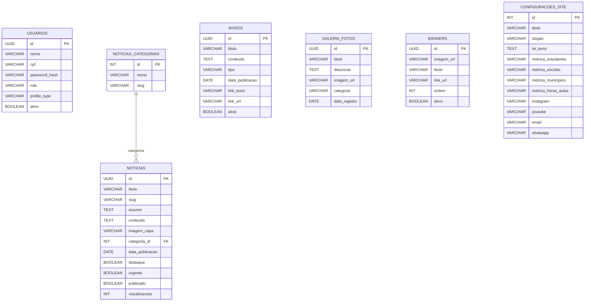

# Especificação Técnica de Banco de Dados e APIs - MEDTEC Rondônia (SEDUC-RO)
## Escopo Inicial: Portal Dinâmico de Notícias, Mídia e CMS

> **Documento de Integração Frontend ➔ Backend**  
> **Destinatário:** Desenvolvedor(a) de Backend e Administrador de Banco de Dados (DBA).  
> **Objetivo:** Criação das tabelas relacionais de produção e dos endpoints da API REST para alimentar todo o portal dinâmico do MEDTEC Rondônia e o Painel Gestor (CMS).

---

## 📑 Sumário

1. [Decisão Arquitetural: Onde salvar Métricas e Textos Institucionais?](#1-decisão-arquitetural-onde-salvar-métricas-e-textos-institucionais)
2. [Estrutura do Banco Relacional (Tabelas do MVP)](#2-estrutura-do-banco-relacional-tabelas-do-mvp)
3. [Dicionário Detalhado das Tabelas](#3-dicionário-detalhado-das-tabelas)
   - [Tabela 1: `usuarios` (Acesso ao Painel CMS)](#tabela-1-usuarios-acesso-ao-painel-cms)
   - [Tabela 2: `noticias_categorias` (Categorias Editoriais)](#tabela-2-noticias_categorias-categorias-editoriais)
   - [Tabela 3: `noticias` (Matérias, Destaques e Visualizações)](#tabela-3-noticias-matérias-destaques-e-visualizações)
   - [Tabela 4: `avisos` (Mural de Comunicados Oficiais)](#tabela-4-avisos-mural-de-comunicados-oficiais)
   - [Tabela 5: `galeria_fotos` (Acervo Fotográfico e Fotos do Site)](#tabela-5-galeria_fotos-acervo-fotográfico-e-fotos-do-site)
   - [Tabela 6: `banners` (Destaques Visuais no Topo)](#tabela-6-banners-destaques-visuais-no-topo)
   - [Tabela 7: `configuracoes_site` (Métricas, Textos Institucionais, Contatos e Redes)](#tabela-7-configuracoes_site-métricas-textos-institucionais-contatos-e-redes)
4. [Diagrama Entidade-Relacionamento (DER Mermaid)](#4-diagrama-entidade-relacionamento-der-mermaid)
5. [Contratos de API REST (Endpoints para o Frontend Dinâmico)](#5-contratos-de-api-rest-endpoints-para-o-frontend-dinâmico)
6. [Script DDL SQL Completo (PostgreSQL 15+)](#6-script-ddl-sql-completo-postgresql-15)
7. [Modelo Prisma ORM (`schema.prisma`)](#7-modelo-prisma-orm-schemaprisma)

---

## 1. Decisão Arquitetural: Onde salvar Métricas e Textos Institucionais?

### ❓ Pergunta:
> *"Sobre métricas e textos institucionais no painel de gestor, será necessário criar uma tabela apenas para isso? Ou deixa na tabela de notícias?"*

### 💡 Resposta Técnica da Engenharia:
**NÃO devem ficar na tabela de notícias.** Eles devem ficar em uma tabela própria: **`configuracoes_site`**.

**Por que não colocar na tabela de notícias?**
1. **Natureza dos Dados Diferente:**  
   - A tabela `noticias` é uma coleção de **múltiplos registros** (cresce todos os dias com dezenas ou centenas de artigos, datas de publicação, autores e visualizações).  
   - Já as **métricas** (*"6.000+ estudantes"*, *"129 escolas"*, *"52 municípios"*) e os **textos institucionais** (*título do hero, slogan, resumo da lei estadual, redes sociais e telefone*) são **dados globais e únicos do site** (representam a identidade institucional ativa).
2. **Evita Inconsistência e Falhas Críticas:**  
   - Se os textos institucionais ou métricas fossem colunas ou linhas dentro da tabela de notícias, caso um operador apagasse ou despublicasse uma notícia, esses textos poderiam ser corrompidos ou excluídos acidentalmente.
3. **Consumo Dinâmico Rápido via API:**  
   - Com a tabela separada `configuracoes_site`, o frontend faz uma única chamada leve (`GET /api/site-info` ou `GET /api/settings`) que entrega instantaneamente o cabeçalho, o rodapé, as métricas e os contatos, enquanto `GET /api/news` cuida exclusivamente das notícias com paginação e busca.

---

## 2. Estrutura do Banco Relacional (Tabelas do MVP)

O banco é composto por **7 tabelas relacionais** essenciais:

| # | Tabela | Finalidade no Frontend |
|---|---|---|
| 1 | **`usuarios`** | Autenticação dos administradores e operadores do painel CMS via CPF e senha criptografada. |
| 2 | **`noticias_categorias`** | Categorias editoriais das notícias (*Infraestrutura*, *Eventos*, *Pedagógico*, *Tecnologia*). |
| 3 | **`noticias`** | Cadastro de matérias completas, slug para URL amigável, imagem de capa, contagem atômica de visualizações e tags. |
| 4 | **`avisos`** | Mural oficial com avisos de prioridade (*urgente*, *aviso*, *informativo*), links de ação e controle de publicação. |
| 5 | **`galeria_fotos`** | Acervo de fotografias do site e comunidades, organizadas por categorias, autor e localidade. |
| 6 | **`banners`** | Imagens e banners em destaque com links de redirecionamento e ordenação. |
| 7 | **`configuracoes_site`** | Tabela dedicada contendo textos do Hero, sobre o MEDTEC, 4 métricas oficiais, links das redes sociais e contatos. |

---

## 3. Dicionário Detalhado das Tabelas

### Tabela 1: `usuarios` (Acesso ao Painel CMS)
Gerencia quem pode acessar `/admin` para publicar notícias, fotos e avisos.

| Coluna | Tipo SQL | Restrições | Descrição |
|---|---|---|---|
| `id` | `UUID` | PK, Default `gen_random_uuid()` | Identificador universal |
| `nome` | `VARCHAR(150)` | NOT NULL | Nome do gestor ou operador |
| `cpf` | `VARCHAR(14)` | UNIQUE, NOT NULL | CPF formatado (`000.000.000-00`) |
| `cpf_limpo` | `VARCHAR(11)` | UNIQUE, NOT NULL | Apenas os 11 dígitos numéricos |
| `password_hash` | `VARCHAR(255)` | NOT NULL | Hash seguro da senha (Bcrypt com salt >= 12 ou Argon2id) |
| `role` | `VARCHAR(30)` | NOT NULL, Default `'operador'` | `'gestor'` ou `'operador'` |
| `profile_type` | `VARCHAR(50)` | NOT NULL | `'Editor de Notícias'`, `'Curador de Fotos'`, `'Publicador de Avisos'`, `'Operador de Conteúdo'` |
| `ativo` | `BOOLEAN` | NOT NULL, Default `TRUE` | Permite ativar/desativar acesso |
| `created_at` | `TIMESTAMPTZ` | Default `NOW()` | Data de criação |
| `updated_at` | `TIMESTAMPTZ` | Default `NOW()` | Última atualização |

---

### Tabela 2: `noticias_categorias` (Categorias Editoriais)
Classificação das reportagens e comunicados de imprensa.

| Coluna | Tipo SQL | Restrições | Descrição |
|---|---|---|---|
| `id` | `SERIAL` | PK | Identificador da categoria |
| `nome` | `VARCHAR(60)` | UNIQUE, NOT NULL | Ex: `'Infraestrutura'`, `'Eventos'`, `'Pedagógico'`, `'Tecnologia'` |
| `slug` | `VARCHAR(60)` | UNIQUE, NOT NULL | Ex: `'infraestrutura'`, `'eventos'` |

---

### Tabela 3: `noticias` (Matérias, Destaques e Visualizações)
Alimenta a Home, a página `/noticias` e as páginas individuais `/noticias/[slug]`.

| Coluna | Tipo SQL | Restrições | Descrição no Frontend |
|---|---|---|---|
| `id` | `UUID` | PK, Default `gen_random_uuid()` | ID da matéria |
| `titulo` | `VARCHAR(250)` | NOT NULL | Título principal da reportagem |
| `slug` | `VARCHAR(280)` | UNIQUE, NOT NULL | URL amigável (`/noticias/inauguracao-polo-nazare`) |
| `resumo` | `TEXT` | NOT NULL | Linha fina/subtítulo exibido nos cards |
| `conteudo` | `TEXT` | NOT NULL | Texto completo da matéria em HTML ou Markdown |
| `imagem_capa` | `VARCHAR(500)` | NOT NULL | URL pública da imagem de capa (no bucket S3/R2/CDN) |
| `autor` | `VARCHAR(100)` | NOT NULL, Default `'SEDUC-RO'` | Jornalista ou equipe de comunicação |
| `categoria_id` | `INT` | FK `noticias_categorias(id)`, NOT NULL | Chave estrangeira para categoria |
| `data_publicacao`| `DATE` | NOT NULL, Default `CURRENT_DATE` | Data oficial exibida no portal |
| `destaque` | `BOOLEAN` | Default `FALSE` | Se verdadeiro, ganha destaque visual no topo |
| `urgente` | `BOOLEAN` | Default `FALSE` | Exibe selo de aviso prioritário |
| `publicado` | `BOOLEAN` | Default `TRUE` | Rascunho (`false`) ou Publicada (`true`) |
| `visualizacoes` | `INTEGER` | Default `0`, NOT NULL | Contador atômico incrementado a cada leitura |
| `tags` | `TEXT[]` | NULL | Array de palavras-chave para filtro e busca |
| `created_at` | `TIMESTAMPTZ` | Default `NOW()` | Data de criação |
| `updated_at` | `TIMESTAMPTZ` | Default `NOW()` | Data de atualização |

---

### Tabela 4: `avisos` (Mural de Comunicados Oficiais)
Alimenta a página `/avisos` e os cards de avisos rápidos da Home.

| Coluna | Tipo SQL | Restrições | Descrição no Frontend |
|---|---|---|---|
| `id` | `UUID` | PK, Default `gen_random_uuid()` | ID do comunicado |
| `titulo` | `VARCHAR(200)` | NOT NULL | Título do aviso |
| `conteudo` | `TEXT` | NOT NULL | Texto do comunicado aberto no modal de leitura |
| `tipo` | `VARCHAR(20)` | NOT NULL | `'urgente'`, `'aviso'`, `'informativo'` |
| `data_publicacao`| `DATE` | NOT NULL, Default `CURRENT_DATE` | Data do comunicado |
| `link_texto` | `VARCHAR(100)` | NULL | Texto do botão de ação (ex: *"Ver Grade Curricular"*) |
| `link_url` | `VARCHAR(500)` | NULL | Destino da ação ou link de documento PDF |
| `ativo` | `BOOLEAN` | Default `TRUE` | Controla visibilidade imediata no site |
| `ordem` | `INTEGER` | Default `0` | Ordenação de exibição |
| `created_at` | `TIMESTAMPTZ` | Default `NOW()` | Data de criação |

---

### Tabela 5: `galeria_fotos` (Acervo Fotográfico e Fotos do Site)
Alimenta a página `/galeria` e a rota `/acervo`.

| Coluna | Tipo SQL | Restrições | Descrição no Frontend |
|---|---|---|---|
| `id` | `UUID` | PK, Default `gen_random_uuid()` | ID da fotografia |
| `titulo` | `VARCHAR(200)` | NOT NULL | Título da fotografia ou do álbum |
| `descricao` | `TEXT` | NULL | Descrição pedagógica da imagem |
| `imagem_url` | `VARCHAR(500)` | NOT NULL | URL pública no CDN/Storage |
| `categoria` | `VARCHAR(60)` | NOT NULL | Ex: `'Estúdios'`, `'Comunidades'`, `'Aulas ao Vivo'`, `'Eventos'` |
| `data_registro` | `DATE` | NOT NULL | Data em que a foto foi tirada |
| `fotografo` | `VARCHAR(100)` | NULL | Crédito fotográfico oficial |
| `localidade` | `VARCHAR(100)` | NULL | Município, comunidade ou escola onde ocorreu |
| `tags` | `TEXT[]` | NULL | Tags para filtros rápidos |
| `created_at` | `TIMESTAMPTZ` | Default `NOW()` | Registro |

---

### Tabela 6: `banners` (Destaques Visuais no Topo)
Imagens de banner rotativo ou cards promocionais de campanhas educacionais.

| Coluna | Tipo SQL | Restrições | Descrição |
|---|---|---|---|
| `id` | `UUID` | PK, Default `gen_random_uuid()` | ID do banner |
| `imagem_url` | `VARCHAR(500)` | NOT NULL | URL da imagem do banner |
| `titulo` | `VARCHAR(150)` | NULL | Título alternativo de acessibilidade (`alt`) |
| `link_url` | `VARCHAR(500)` | NULL | Link de redirecionamento ao clicar |
| `ordem` | `INTEGER` | Default `0` | Prioridade na exibição |
| `ativo` | `BOOLEAN` | Default `TRUE` | Ativo ou pausado |

---

### Tabela 7: `configuracoes_site` (Métricas, Textos Institucionais, Contatos e Redes)
**Tabela Singleton (1 linha única com `id = 1`)**: Centraliza os textos institucionais, métricas oficiais, dados de contato e redes sociais oficiais da SEDUC. O painel de gestor edita esta tabela via `PUT /api/site-info`.

| Coluna | Tipo SQL | Restrições | Descrição no Frontend |
|---|---|---|---|
| `id` | `INT` | PK, CHECK (`id = 1`) | Garante que existe apenas 1 configuração ativa |
| **Textos Institucionais** | | | |
| `titulo` | `VARCHAR(150)` | NOT NULL, Default `'MEDTEC Rondônia'` | Nome oficial |
| `slogan` | `VARCHAR(250)` | NOT NULL | *"Ensino Médio com Mediação Tecnológica"* |
| `lei_texto` | `TEXT` | NOT NULL | *"Lei Estadual nº 3.846/2016 e Portaria SEDUC nº 928/2025"* |
| `sobre_titulo` | `VARCHAR(200)` | NOT NULL | Título da seção sobre o programa |
| `sobre_texto` | `TEXT` | NOT NULL | Descrição oficial da política pública |
| `hero_badge` | `VARCHAR(100)` | NOT NULL | Badge no topo (ex: *"Governo de Rondônia • SEDUC"*) |
| `hero_titulo` | `VARCHAR(250)` | NOT NULL | Título principal da dobra inicial da Home |
| `hero_descricao`| `TEXT` | NOT NULL | Texto descritivo do Hero |
| `hero_imagem` | `VARCHAR(500)` | NOT NULL | URL da foto dos estudantes em sala conectada |
| `estudio_imagem`| `VARCHAR(500)`| NOT NULL | URL da foto da transmissão nos estúdios centrais |
| `url_video_apresentacao`| `VARCHAR(500)`| NULL | Link do vídeo institucional (YouTube) |
| **Métricas Oficiais** | | | |
| `metrica_estudantes` | `VARCHAR(30)` | NOT NULL, Default `'6.000+'` | Total de estudantes atendidos |
| `metrica_escolas` | `VARCHAR(30)` | NOT NULL, Default `'129'` | Unidades escolares conectadas |
| `metrica_municipios` | `VARCHAR(30)` | NOT NULL, Default `'52'` | Municípios cobertos no estado |
| `metrica_horas_aulas` | `VARCHAR(30)` | NOT NULL, Default `'1.200h+'` | Total de horas de transmissão ao vivo |
| **Redes Sociais Oficiais** | | | |
| `instagram` | `VARCHAR(250)` | NULL | URL do Instagram oficial |
| `youtube` | `VARCHAR(250)` | NULL | Canal do YouTube das transmissões ao vivo |
| `facebook` | `VARCHAR(250)` | NULL | Página oficial do Facebook |
| `tiktok` | `VARCHAR(250)` | NULL | Perfil institucional no TikTok |
| **Contatos e Endereço Oficial** | | | |
| `whatsapp` | `VARCHAR(50)` | NULL | WhatsApp oficial de suporte escolar |
| `telefone` | `VARCHAR(50)` | NULL | Telefone institucional da SEDUC |
| `email` | `VARCHAR(120)` | NULL | E-mail de atendimento da Coordenadoria |
| `endereco` | `VARCHAR(300)` | NULL | Palácio Rio Madeira, Edifício Rio Guaporé, Porto Velho - RO |
| `updated_at` | `TIMESTAMPTZ` | Default `NOW()` | Data da última alteração no painel |

---

## 4. Diagrama Entidade-Relacionamento (DER Mermaid)



---

## 5. Contratos de API REST (Endpoints para o Frontend Dinâmico)

O frontend consome esses endpoints para exibir os dados dinamicamente e permitir o gerenciamento via CMS.

### 🔐 Autenticação (`/api/auth`)
| Método | Rota | Permissão | Descrição |
|---|---|---|---|
| `POST` | `/api/auth/login` | Pública | Autentica com `{ username, password }` e devolve Cookie `HttpOnly`. |
| `GET` | `/api/auth/me` | Autenticada | Retorna dados do operador logado e suas permissões. |
| `POST` | `/api/auth/logout` | Autenticada | Encerra a sessão. |

### 🌐 Informações Globais, Métricas e Contatos (`/api/site-info`)
| Método | Rota | Permissão | Descrição |
|---|---|---|---|
| `GET` | `/api/site-info` | Pública | Retorna todas as configurações da tabela `configuracoes_site` (Hero, métricas, redes e contatos). |
| `PUT` | `/api/site-info` | Gestor Autenticado | Atualiza as métricas e textos institucionais pelo CMS. |

### 📰 Notícias (`/api/news`)
| Método | Rota | Permissão | Descrição |
|---|---|---|---|
| `GET` | `/api/news` | Pública | Lista notícias com paginação e filtros (`?page=1&limit=9&category=...&search=...`). |
| `GET` | `/api/news/:slug` | Pública | Retorna o detalhe da notícia pelo slug para a página individual. |
| `POST` | `/api/news/:id/view` | Pública | Incrementa `visualizacoes` em +1 (atômico) a cada leitura. |
| `POST` | `/api/news` | Editor/Gestor | Cadastra nova notícia com foto de capa e tags. |
| `PUT` | `/api/news/:id` | Editor/Gestor | Atualiza notícia existente. |
| `DELETE`| `/api/news/:id` | Editor/Gestor | Remove notícia. |

### 📢 Avisos Oficiais (`/api/announcements`)
| Método | Rota | Permissão | Descrição |
|---|---|---|---|
| `GET` | `/api/announcements` | Pública | Lista todos os avisos ativos para o mural e a Home. |
| `POST` | `/api/announcements` | Publicador/Gestor | Cria novo comunicado oficial. |
| `PUT` | `/api/announcements/:id`| Publicador/Gestor | Edita comunicado. |
| `DELETE`| `/api/announcements/:id`| Publicador/Gestor | Remove comunicado. |

### 📸 Galeria de Fotos (`/api/gallery`)
| Método | Rota | Permissão | Descrição |
|---|---|---|---|
| `GET` | `/api/gallery` | Pública | Lista fotografias com filtros por categoria. |
| `POST` | `/api/gallery` | Curador/Gestor | Adiciona fotos ao acervo com metadados e tags. |
| `DELETE`| `/api/gallery/:id` | Curador/Gestor | Exclui fotografia. |

### 🖼️ Banners (`/api/banners`)
| Método | Rota | Permissão | Descrição |
|---|---|---|---|
| `GET` | `/api/banners` | Pública | Retorna banners ativos ordenados por `ordem`. |
| `POST` | `/api/banners` | Gestor | Adiciona novo banner. |
| `DELETE`| `/api/banners/:id` | Gestor | Remove banner. |

### 📁 Upload de Fotos (`/api/upload`)
| Método | Rota | Permissão | Descrição |
|---|---|---|---|
| `POST` | `/api/upload` | Operador Autenticado | Recebe arquivo via `multipart/form-data`, salva no S3/R2 e retorna a URL pública gerada. |

---

## 6. Script DDL SQL Completo (PostgreSQL 15+)

Copie e execute o script abaixo no PostgreSQL para criar o banco completo em segundos:

```sql
-- 1. Habilitar extensão de UUID
CREATE EXTENSION IF NOT EXISTS "uuid-ossp";

-- 2. Tabela de Usuários Operadores do CMS
CREATE TABLE usuarios (
    id UUID PRIMARY KEY DEFAULT gen_random_uuid(),
    nome VARCHAR(150) NOT NULL,
    cpf VARCHAR(14) UNIQUE NOT NULL,
    cpf_limpo VARCHAR(11) UNIQUE NOT NULL,
    password_hash VARCHAR(255) NOT NULL,
    role VARCHAR(30) NOT NULL DEFAULT 'operador' CHECK (role IN ('gestor', 'operador')),
    profile_type VARCHAR(50) NOT NULL CHECK (profile_type IN (
        'Editor de Notícias', 
        'Curador de Fotos', 
        'Publicador de Avisos', 
        'Operador de Conteúdo'
    )),
    ativo BOOLEAN NOT NULL DEFAULT TRUE,
    created_at TIMESTAMPTZ NOT NULL DEFAULT NOW(),
    updated_at TIMESTAMPTZ NOT NULL DEFAULT NOW()
);

-- 3. Categorias de Notícias
CREATE TABLE noticias_categorias (
    id SERIAL PRIMARY KEY,
    nome VARCHAR(60) UNIQUE NOT NULL,
    slug VARCHAR(60) UNIQUE NOT NULL
);

-- Inserir categorias padrão
INSERT INTO noticias_categorias (nome, slug) VALUES 
('Infraestrutura', 'infraestrutura'),
('Eventos', 'eventos'),
('Pedagógico', 'pedagogico'),
('Tecnologia', 'tecnologia');

-- 4. Notícias
CREATE TABLE noticias (
    id UUID PRIMARY KEY DEFAULT gen_random_uuid(),
    titulo VARCHAR(250) NOT NULL,
    slug VARCHAR(280) UNIQUE NOT NULL,
    resumo TEXT NOT NULL,
    conteudo TEXT NOT NULL,
    imagem_capa VARCHAR(500) NOT NULL,
    autor VARCHAR(100) NOT NULL DEFAULT 'SEDUC-RO',
    categoria_id INT NOT NULL REFERENCES noticias_categorias(id) ON DELETE RESTRICT,
    data_publicacao DATE NOT NULL DEFAULT CURRENT_DATE,
    destaque BOOLEAN NOT NULL DEFAULT FALSE,
    urgente BOOLEAN NOT NULL DEFAULT FALSE,
    publicado BOOLEAN NOT NULL DEFAULT TRUE,
    visualizacoes INT NOT NULL DEFAULT 0,
    tags TEXT[],
    created_at TIMESTAMPTZ NOT NULL DEFAULT NOW(),
    updated_at TIMESTAMPTZ NOT NULL DEFAULT NOW()
);

-- Índices para navegação rápida de notícias
CREATE INDEX idx_noticias_slug ON noticias(slug);
CREATE INDEX idx_noticias_data ON noticias(data_publicacao DESC);
CREATE INDEX idx_noticias_destaque ON noticias(destaque) WHERE publicado = TRUE;
CREATE INDEX idx_noticias_categoria ON noticias(categoria_id);

-- 5. Mural de Avisos
CREATE TABLE avisos (
    id UUID PRIMARY KEY DEFAULT gen_random_uuid(),
    titulo VARCHAR(200) NOT NULL,
    conteudo TEXT NOT NULL,
    tipo VARCHAR(20) NOT NULL CHECK (tipo IN ('urgente', 'aviso', 'informativo')),
    data_publicacao DATE NOT NULL DEFAULT CURRENT_DATE,
    link_texto VARCHAR(100),
    link_url VARCHAR(500),
    ativo BOOLEAN NOT NULL DEFAULT TRUE,
    ordem INT NOT NULL DEFAULT 0,
    created_at TIMESTAMPTZ NOT NULL DEFAULT NOW()
);

CREATE INDEX idx_avisos_ativo ON avisos(ativo, data_publicacao DESC);

-- 6. Galeria de Fotos
CREATE TABLE galeria_fotos (
    id UUID PRIMARY KEY DEFAULT gen_random_uuid(),
    titulo VARCHAR(200) NOT NULL,
    descricao TEXT,
    imagem_url VARCHAR(500) NOT NULL,
    categoria VARCHAR(60) NOT NULL,
    data_registro DATE NOT NULL DEFAULT CURRENT_DATE,
    fotografo VARCHAR(100),
    localidade VARCHAR(100),
    tags TEXT[],
    created_at TIMESTAMPTZ NOT NULL DEFAULT NOW()
);

CREATE INDEX idx_galeria_categoria ON galeria_fotos(categoria);

-- 7. Banners
CREATE TABLE banners (
    id UUID PRIMARY KEY DEFAULT gen_random_uuid(),
    imagem_url VARCHAR(500) NOT NULL,
    titulo VARCHAR(150),
    link_url VARCHAR(500),
    ordem INT NOT NULL DEFAULT 0,
    ativo BOOLEAN NOT NULL DEFAULT TRUE
);

-- 8. Configurações Globais do Site (Textos Institucionais, Métricas, Redes e Contatos)
CREATE TABLE configuracoes_site (
    id INT PRIMARY KEY DEFAULT 1 CHECK (id = 1),
    titulo VARCHAR(150) NOT NULL DEFAULT 'MEDTEC Rondônia',
    slogan VARCHAR(250) NOT NULL DEFAULT 'Ensino Médio com Mediação Tecnológica',
    lei_texto TEXT NOT NULL DEFAULT 'Lei Estadual nº 3.846/2016 e Portaria SEDUC nº 928/2025',
    sobre_titulo VARCHAR(200) NOT NULL DEFAULT 'Sobre a Mediação Tecnológica',
    sobre_texto TEXT NOT NULL,
    hero_badge VARCHAR(100) NOT NULL DEFAULT 'Governo de Rondônia • SEDUC',
    hero_titulo VARCHAR(250) NOT NULL,
    hero_descricao TEXT NOT NULL,
    hero_imagem VARCHAR(500) NOT NULL,
    estudio_imagem VARCHAR(500) NOT NULL,
    url_video_apresentacao VARCHAR(500),
    -- Métricas Oficiais
    metrica_estudantes VARCHAR(30) NOT NULL DEFAULT '6.000+',
    metrica_escolas VARCHAR(30) NOT NULL DEFAULT '129',
    metrica_municipios VARCHAR(30) NOT NULL DEFAULT '52',
    metrica_horas_aulas VARCHAR(30) NOT NULL DEFAULT '1.200h+',
    -- Redes Sociais
    instagram VARCHAR(250),
    youtube VARCHAR(250),
    facebook VARCHAR(250),
    tiktok VARCHAR(250),
    -- Contatos
    whatsapp VARCHAR(50),
    telefone VARCHAR(50),
    email VARCHAR(120),
    endereco VARCHAR(300),
    updated_at TIMESTAMPTZ NOT NULL DEFAULT NOW()
);

-- Inserir o registro único inicial com os dados oficiais do MEDTEC
INSERT INTO configuracoes_site (
    id, titulo, slogan, lei_texto, sobre_titulo, sobre_texto, hero_badge,
    hero_titulo, hero_descricao, hero_imagem, estudio_imagem,
    metrica_estudantes, metrica_escolas, metrica_municipios, metrica_horas_aulas,
    instagram, youtube, facebook, whatsapp, email, endereco
) VALUES (
    1,
    'MEDTEC Rondônia',
    'Ensino Médio com Mediação Tecnológica',
    'Lei Estadual nº 3.846/2016 e Portaria SEDUC nº 928/2025',
    'Mediação Tecnológica Educacional',
    'A Mediação Tecnológica (MEDTEC) é a política pública do Governo de Rondônia (SEDUC-RO) que leva o Ensino Médio regular de excelência a comunidades ribeirinhas, indígenas e assentamentos rurais em todo o estado.',
    'Governo do Estado de Rondônia • SEDUC',
    'Educação Pública de Qualidade Onde o Rio e a Estrada Chegam',
    'Aulas ao vivo via satélite transmitidas diariamente dos estúdios centrais da SEDUC em Porto Velho para salas de aula conectadas em todos os 52 municípios de Rondônia.',
    'https://images.unsplash.com/photo-1577896851231-70ef18881754?auto=format&fit=crop&w=1200&q=80',
    'https://images.unsplash.com/photo-1598488035139-bdbb2231ce04?auto=format&fit=crop&w=800&q=75',
    '6.000+',
    '129',
    '52',
    '1.200h+',
    'https://instagram.com/seducro',
    'https://youtube.com/@seducrondonia',
    'https://facebook.com/seducro',
    '(69) 99999-9999',
    'medtec@seduc.ro.gov.br',
    'Palácio Rio Madeira, Edifício Rio Guaporé, Porto Velho - RO'
);
```

---

## 7. Modelo Prisma ORM (`schema.prisma`)

Se o backend for desenvolvido em **Node.js / NestJS / TypeScript com Prisma**, o arquivo `schema.prisma` equivalente é:

```prisma
datasource db {
  provider = "postgresql"
  url      = env("DATABASE_URL")
}

generator client {
  provider = "prisma-client-js"
}

enum Role {
  gestor
  operador
}

enum ProfileType {
  EDITOR_NOTICIAS   @map("Editor de Notícias")
  CURADOR_FOTOS     @map("Curador de Fotos")
  PUBLICADOR_AVISOS @map("Publicador de Avisos")
  OPERADOR_CONTEUDO @map("Operador de Conteúdo")
}

enum AnnouncementType {
  urgente
  aviso
  informativo
}

model Usuario {
  id           String      @id @default(uuid()) @db.Uuid
  nome         String      @db.VarChar(150)
  cpf          String      @unique @db.VarChar(14)
  cpfLimpo     String      @unique @map("cpf_limpo") @db.VarChar(11)
  passwordHash String      @map("password_hash") @db.VarChar(255)
  role         Role        @default(operador)
  profileType  ProfileType @map("profile_type")
  ativo        Boolean     @default(true)
  createdAt    DateTime    @default(now()) @map("created_at") @db.Timestamptz
  updatedAt    DateTime    @updatedAt @map("updated_at") @db.Timestamptz

  @@map("usuarios")
}

model NoticiaCategoria {
  id       Int       @id @default(autoincrement())
  nome     String    @unique @db.VarChar(60)
  slug     String    @unique @db.VarChar(60)
  noticias Noticia[]

  @@map("noticias_categorias")
}

model Noticia {
  id             String           @id @default(uuid()) @db.Uuid
  titulo         String           @db.VarChar(250)
  slug           String           @unique @db.VarChar(280)
  resumo         String           @db.Text
  conteudo       String           @db.Text
  imagemCapa     String           @map("imagem_capa") @db.VarChar(500)
  autor          String           @default("SEDUC-RO") @db.VarChar(100)
  categoriaId    Int              @map("categoria_id")
  dataPublicacao DateTime         @default(now()) @map("data_publicacao") @db.Date
  destaque       Boolean          @default(false)
  urgente        Boolean          @default(false)
  publicado      Boolean          @default(true)
  visualizacoes  Int              @default(0)
  tags           String[]
  createdAt      DateTime         @default(now()) @map("created_at") @db.Timestamptz
  updatedAt      DateTime         @updatedAt @map("updated_at") @db.Timestamptz

  categoria      NoticiaCategoria @relation(fields: [categoriaId], references: [id])

  @@index([slug])
  @@index([dataPublicacao(sort: Desc)])
  @@index([destaque])
  @@map("noticias")
}

model Aviso {
  id             String           @id @default(uuid()) @db.Uuid
  titulo         String           @db.VarChar(200)
  conteudo       String           @db.Text
  tipo           AnnouncementType
  dataPublicacao DateTime         @default(now()) @map("data_publicacao") @db.Date
  linkTexto      String?          @map("link_texto") @db.VarChar(100)
  linkUrl        String?          @map("link_url") @db.VarChar(500)
  ativo          Boolean          @default(true)
  ordem          Int              @default(0)
  createdAt      DateTime         @default(now()) @map("created_at") @db.Timestamptz

  @@index([ativo, dataPublicacao(sort: Desc)])
  @@map("avisos")
}

model GaleriaFoto {
  id           String   @id @default(uuid()) @db.Uuid
  titulo       String   @db.VarChar(200)
  descricao    String?  @db.Text
  imagemUrl    String   @map("imagem_url") @db.VarChar(500)
  categoria    String   @db.VarChar(60)
  dataRegistro DateTime @default(now()) @map("data_registro") @db.Date
  fotografo    String?  @db.VarChar(100)
  localidade   String?  @db.VarChar(100)
  tags         String[]
  createdAt    DateTime @default(now()) @map("created_at") @db.Timestamptz

  @@map("galeria_fotos")
}

model Banner {
  id        String  @id @default(uuid()) @db.Uuid
  imagemUrl String  @map("imagem_url") @db.VarChar(500)
  titulo    String? @db.VarChar(150)
  linkUrl   String? @map("link_url") @db.VarChar(500)
  ordem     Int     @default(0)
  ativo     Boolean @default(true)

  @@map("banners")
}

model ConfiguracoesSite {
  id                     Int      @id @default(1)
  titulo                 String   @default("MEDTEC Rondônia") @db.VarChar(150)
  slogan                 String   @default("Ensino Médio com Mediação Tecnológica") @db.VarChar(250)
  leiTexto               String   @map("lei_texto") @db.Text
  sobreTitulo            String   @map("sobre_titulo") @db.VarChar(200)
  sobreTexto             String   @map("sobre_texto") @db.Text
  heroBadge              String   @map("hero_badge") @db.VarChar(100)
  heroTitulo             String   @map("hero_titulo") @db.VarChar(250)
  heroDescricao          String   @map("hero_descricao") @db.Text
  heroImagem             String   @map("hero_imagem") @db.VarChar(500)
  estudioImagem          String   @map("estudio_imagem") @db.VarChar(500)
  urlVideoApresentacao   String?  @map("url_video_apresentacao") @db.VarChar(500)
  
  // Métricas Oficiais
  metricaEstudantes      String   @default("6.000+") @map("metrica_estudantes") @db.VarChar(30)
  metricaEscolas         String   @default("129") @map("metrica_escolas") @db.VarChar(30)
  metricaMunicipios      String   @default("52") @map("metrica_municipios") @db.VarChar(30)
  metricaHorasAulas      String   @default("1.200h+") @map("metrica_horas_aulas") @db.VarChar(30)
  
  // Redes Sociais
  instagram              String?  @db.VarChar(250)
  youtube                String?  @db.VarChar(250)
  facebook               String?  @db.VarChar(250)
  tiktok                 String?  @db.VarChar(250)
  
  // Contatos
  whatsapp               String?  @db.VarChar(50)
  telefone               String?  @db.VarChar(50)
  email                  String?  @db.VarChar(120)
  endereco               String?  @db.VarChar(300)
  
  updatedAt              DateTime @updatedAt @map("updated_at") @db.Timestamptz

  @@map("configuracoes_site")
}
```

---

*Documento técnico atualizado e customizado para o escopo inicial dinâmico do MEDTEC Rondônia (SEDUC-RO).*
