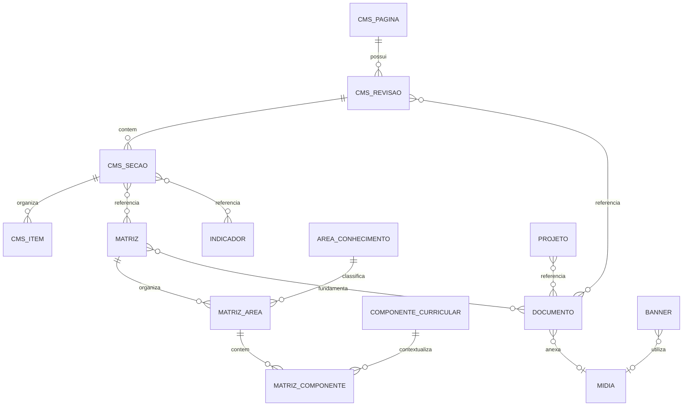

# MEDTEC — Especificação proposta de contratos Rails para o CMS

Data: **31/10/2026**. Branch auditada: `feature/evolucao-cms-institucional`.
Relacionado: [inventário, arquitetura administrativa e plano incremental](CMS_MAPEAMENTO_CONTEUDOS.md).

**Documento para análise e aceite da equipe Rails. Nenhuma rota nova deste documento foi implementada, consultada ou homologada.** Os caminhos N são propostas relativas à base Rails `/api/v1`; não são handlers Next.js. A nomenclatura final deve ser ratificada pelo backend antes de criar serviços/telas integrados.

## 1. Evidências e classificação de contratos

| Código | Significado | Limite |
|---|---|---|
| E | Endpoint existente e confirmado documentalmente e no código de integração | Há contrato e serviço/consumidor. Não significa confirmação por chamada ao servidor nesta auditoria. |
| D | Endpoint documentado, mas não homologado | Contrato complementar e serviços existentes; relatórios C1–D registram merge/homologação pendentes. |
| N | Endpoint novo proposto | Não encontrado nos contratos/serviços auditados. Depende de aceite, implementação e homologação Rails. |
| L | Handler/persistência local ou conteúdo fixo | Não é contrato Rails; não usar como substituto de N. |

Fontes: [ROTAS_FRONT.md](../ROTAS_FRONT.md), [ROTAS_FRONT_FULL.md](ROTAS_FRONT_FULL.md), [guia anterior](rotas_front.md), `src/lib/api/services/*.ts`, `src/lib/api/types.ts` e relatórios recentes. Foi lido também `/home/lennon/Downloads/ROTAS_NOVAS_AVISOS_DUVIDAS.md`, citado nos [lotes C1](LOTE_C1_RELATORIO.md), [C2](LOTE_C2_RELATORIO.md), [C3](LOTE_C3_RELATORIO.md) e [D](LOTE_D_RELATORIO.md); esse arquivo externo deve ser disponibilizado/versionado pela equipe responsável.

Não existe código Rails neste checkout. Sem chamadas HTTP ou mutações nesta auditoria, não se afirma homologação de nenhuma rota ou perfil. **E confirma a integração existente no repositório; D destaca a pendência expressamente documentada.** A primeira etapa conjunta deverá registrar ambiente, release/commit do Rails, data, responsável e resultados de homologação.

### 1.1 Catálogo E — preservar e reutilizar

Na tabela, “CRUD” expande exatamente para `GET /recurso`, `GET /recurso/:id`, `POST /recurso`, `PATCH /recurso/:id`, `DELETE /recurso/:id`.

| Recursos / métodos existentes | Evidência no frontend | Uso no CMS completo |
|---|---|---|
| `POST /auth/login`, `POST /auth/refresh_token`, `GET /auth/me`, `DELETE /auth/logout` | `auth.service.ts`, guia §§1–5 | Sessão Rails do usuário real, token e refresh coordenado. |
| CRUD `/usuarios`, `/perfis` | Serviços de usuários/perfis, guia §§6–7 | Equipe e perfis existentes; não duplicar contas. |
| `GET/PUT /perfis/:id/permissoes`, `GET/PUT /usuarios/:id/permissoes_extras` | Serviços de perfis/usuários, guia §§8–9 | Cadastrar novas regras no mecanismo existente; autorização final Rails. |
| CRUD `/g_estados`, `/g_cidades` | `geografia.service.ts`, guia §§10–11 | Relacionar cidade em projetos, escolas e perfis, sem catálogo geográfico paralelo. |
| CRUD `/a_tipos_aviso`, `/a_avisos` | `avisos.service.ts`, guia §§12–13 | Avisos/tipos existentes, ativação por `ativo`. |
| CRUD `/categorias_galeria`, `/fotos_galeria` | `galeria.service.ts`, guia §§14–15 | Fotografias/categorias e upload existente; estender campos/publicação apenas se aprovado. |
| `GET /canais_contato`, `PUT /canais_contato` | `canais.service.ts`, `admin-channels.ts`, guia §16 | Lista fixa de sete redes; atualização em lote atômica; não criar CRUD paralelo de contatos. |
| CRUD `/n_noticias`; `PATCH /n_noticias/:id/publicar`, `/reprovar`, `/despublicar` | `noticias.service.ts`, guia §18 | Mesmo fluxo editorial e autor definido pelo Rails. |
| CRUD `/n_categorias_noticia`; `GET /n_status_noticias` | Serviço de notícias, guia §18 | Categorias existentes e status somente leitura. |
| `GET /publico/n_noticias`, `GET /publico/n_noticias/:slug`, `GET /publico/n_categorias_noticia` | Serviço de notícias e páginas públicas, guia §19 | Notícias públicas; não enviar Bearer nem obter token administrativo no servidor para renderizar o portal. |

Convenções existentes a preservar: listas usam envelope `success/message/data.items/data.pagination`; vários detalhes/POST/PATCH administrativos retornam objeto direto; DELETE responde 204. O público de notícias usa envelope. Canais em lote respondem envelope com array. Não converter tudo para um formato novo sem versão/migração.

Notícias: estados `aguardando`, `reprovada`, `publicada`; data futura significa agendamento, sem campo `agendada` próprio. A criação não aceita status/autor do cliente; reprovação recebe `{ "motivo": "..." }`. Avisos e canais usam `ativo`, não esses estados. O CRUD de galeria não possui status editorial no DTO atual.

### 1.2 Catálogo D — integrar o que já foi especificado, sem redesenhar

| Métodos / caminhos | Contrato e situação |
|---|---|
| `GET /publico/a_avisos` | Ativos com tipo ativo; `tipo` por slug, mais novos primeiro, envelope paginado. Implementado em serviço e `/avisos`/`/ao-vivo`; homologação não comprovada. |
| CRUD `/d_categorias_duvida` | Categoria com nome, slug e ativo; impedir exclusão com dúvidas. Lote C1. |
| CRUD `/d_duvidas`; `PATCH /d_duvidas/:id/publicar`, `/reprovar`, `/despublicar` | Pergunta/resposta/categoria; autor e estado definidos pelo Rails. Reprovar não recebe motivo, diferentemente de notícias. Lote C2. |
| `GET /d_duvidas_visitante`, `GET /d_duvidas_visitante/:id`, `PATCH /d_duvidas_visitante/:id/responder`, `DELETE /d_duvidas_visitante/:id` | Caixa de atendimento; responder registra atendimento externo, sem enviar e-mail e sem criar FAQ automaticamente. Lote C3. |
| `GET /publico/d_duvidas`, `GET /publico/d_categorias_duvida`, `POST /publico/d_duvidas_visitante` | FAQ público e formulário; envio retorna 201, envelope e `data: null`, com limite 429. Lote D. |

As dúvidas usam `aguardando/reprovada/publicada`. Pelo contrato complementar, usuário com permissão Publicar pode criar dúvida já publicada; isso não deve ser copiado para o CMS novo sem decisão explícita. Categorias públicas são array em `data`, sem paginação. Não propor outro recurso de FAQ/visitantes nem reativar `/api/faqs`.

### 1.3 Ausências constatadas e fronteira do escopo

Não foi encontrado contrato Rails para páginas/seções/cards, matrizes, áreas/componentes, documentos/PDF, banners, indicadores públicos, projetos, perfis docentes, histórias de estudantes, unidades escolares ou contratos de transparência. Também faltam leituras públicas confirmadas de canais e galeria.

`GET /api/data`, `PUT /api/data`, `/api/upload` e handlers vazios de projetos/professores/alunos/escolas/transparência pertencem ao Next.js (L). A existência dessas rotas não implementa as necessidades Rails abaixo. Nenhum handler frontend novo é proposto.

## 2. Decisões arquiteturais propostas (N)

1. **Página é agregado editorial.** Seções e cards pertencem à revisão da página, com gravação/publicação atômicas; não há endpoint para “card do satélite” ou “card do mediador”.
2. **Templates controlados.** Tipo, campos e referências permitidos são validados no Rails e renderizados por templates conhecidos no frontend. Sem JSX/HTML arbitrário, CSS, JavaScript ou nomes de componentes no payload.
3. **Matriz é domínio estruturado.** Catálogos de áreas/componentes, associações contextuais, documentos e metadados oficiais. As duas matrizes são registros da mesma entidade.
4. **Reutilização de recursos.** Página referencia matriz/indicador/projeto/documento por ID; notícias, FAQ, avisos, contatos e fotos continuam nos recursos existentes. Catálogo de mídia novo atende assets institucionais/PDF, sem substituir o CRUD da galeria.
5. **Rascunho separado da publicação.** `PATCH` grava rascunho; publicar é ação explícita autorizada. Alterar um conteúdo publicado não modifica sua versão pública até promoção.
6. **Uma fonte oficial.** Rails mantém dados, autoria, publicação, anexos e autorização; o frontend mantém somente estado transitório de formulário. Sem `localStorage`, arquivo JSON ou mock para persistência de conteúdo.
7. **Primeira versão sem agendamento genérico, colaboração em tempo real ou construtor livre.** O agendamento de notícias existente permanece como está. Revisão/aprovação em múltiplos passos pode ser extensão posterior.



O diagrama mostra entidades lógicas; associações e índices devem existir no Rails. Seções/itens pertencem à revisão, sem controllers próprios. Metadados tipados podem usar JSONB com schema versionado; relações com outros recursos devem ser verificadas e indexadas para consulta de usos, sem IDs soltos não validados.

## 3. Convenções transversais dos recursos N

### 3.1 Tipos, identificação e validação

| Campo/regra | Contrato proposto |
|---|---|
| `id` | Inteiro positivo emitido pelo Rails; campos `*_id` têm FK válida. IDs de exemplos são ilustrativos. |
| `codigo`, `slug`, `chave` | String minúscula com `[a-z0-9-]`, até 100 caracteres; unicidade no escopo definido; rotas/âncoras estruturais protegidas de renomeação acidental. |
| Strings | UTF-8, trim; limites de título 180, resumo/descrição curta 1.000, corpo 50.000 e rótulo/selo 100 caracteres, salvo limites específicos. Sem texto obrigatório vazio. |
| Conteúdo textual | Texto simples na primeira versão; links separados e listas tipadas. Rich text futuro requer schema e sanitização servidor, não `dangerouslySetInnerHTML` livre. |
| Tempo | `date` em `YYYY-MM-DD`; timestamps ISO 8601 com offset ou UTC. Exibição em `America/Porto_Velho`. Datas de publicação são do servidor; vigência/data de referência são dados editoriais. |
| Ordem | Inteiro `posicao >= 1`; única dentro de arrays de seção/itens/vínculos da mesma revisão. Recursos editoriais independentes podem empatar, com desempate por `id`. Alterar a ordem de uma árvore de página/matriz é atômico. |
| URLs | HTTPS para fontes externas em produção; links internos somente rotas/âncoras permitidas. Rejeitar `javascript:`, `data:`, `file:`, protocol-relative e redirecionamento arbitrário. `mailto`/`tel` só em campos próprios de contato. |
| Auditoria | `created_at`, `updated_at`, `autor_id`, `atualizado_por_id`, `publicado_por_id`, `publicado_em`, `despublicado_em` definidos pelo Rails; trilha de eventos com usuário/recurso/versão/ação. |
| Campos protegidos | Status, autoria, revisões, URLs de arquivo e capacidades são somente leitura; rejeitar tentativa de alterá-los na gravação comum. Não mass-assign de campos desconhecidos. |
| Exclusão | Lógica para recursos editoriais; 409 se publicado ou referenciado; catálogos com vínculos não podem ser apagados. Nenhuma exclusão em cascata de outros conteúdos. |

### 3.2 Envelope e códigos

Para os novos contratos, preservar padrão do projeto:

- `GET` de coleção: 200 com envelope paginado.
- `GET` administrativo de um registro: 200 objeto direto; `POST`: 201 objeto direto e `Location`; `PATCH`: 200 objeto direto.
- `PATCH /publicar` e `/despublicar`: 200 objeto direto; `GET /preview`: 200 envelope com DTO de apresentação e metadados de prévia.
- `DELETE`: 204 sem corpo. Público: 200 envelope com DTO público, nunca objeto administrativo.
- Erros: envelope com `success: false`, `message`, `errors: string[]`, `timestamp`; extensão opcional `field_errors` para apontar campos/caminhos e `codigo` para decisões da UI.

| HTTP | Código/condição propostos | Comportamento esperado |
|---|---|---|
| 400 | `parametros_invalidos`, JSON ou raiz ausente | Corrigir requisição; não persistir parte do corpo. |
| 401 | Códigos existentes: `nao_autenticado`, `token_expirado`, `token_revogado`, `usuario_inativo` | Renovar somente conforme cliente existente; caso contrário, login. |
| 403 | `sem_permissao` | Não inferir sucesso/alterar estado; mostrar falta de acesso. |
| 404 | `registro_nao_encontrado` | Inclui rascunho/despublicado/excluído consultado anonimamente. Não revelar existência privada. |
| 409 | `recurso_em_uso`, `dependencias_publicadas`, `estado_incompativel` | Mostrar dependências/ação necessária, sem operação parcial. |
| 412 | `versao_conflitante` | Edição concorrente: recarregar/comparar com rascunho do servidor, sem sobrescrever. |
| 413 | `arquivo_muito_grande` | Corrigir arquivo; preservar formulário. |
| 415 | `tipo_arquivo_nao_permitido` | Rejeitar MIME/assinatura não permitidos. |
| 422 | `validacao_falhou`, `referencia_invalida`, `schema_nao_suportado` | Erros por campo; nada salvo/publicado parcialmente. |
| 428 | `versao_obrigatoria` | Enviar precondição de concorrência nas alterações existentes. |
| 429 | `muitas_tentativas` | Respeitar `Retry-After`, sem reenvio automático contínuo. |
| 500/503 | `erro_interno` / `servico_indisponivel` | Mensagem segura e request ID; não devolver stack/credenciais. |

São códigos **propostos para N**; não presumir que os serviços existentes já retornam as extensões.

### 3.3 Paginação, busca e ordenação

Coleções administrativas: `page=1`, `per_page=20`, máximo 100; envelope com `current_page`, `total_pages`, `total_count`, `per_page`. Público: padrão 10, máximo 100. Zero registros: HTTP 200, `items: []`, `total_count: 0`, `total_pages: 0`, `current_page: 1`. Página além do fim: 200 com `items: []`, total real; frontend pode ajustar para a última válida.

Filtros administrativos seguem `q[campo_predicado]` com allowlist por recurso; busca pública `busca`, sem Ransack arbitrário. Ordenação administrativa `q[s]=posicao asc` ou outro campo explicitamente permitido; rejeitar campos/sentidos desconhecidos. Critério secundário sempre `id`. `page=all` somente para pequenos catálogos (templates, áreas, componentes ativos e geografia existente); bibliotecas/páginas/projetos precisam de seletor paginado, sem carregar tudo por conveniência.

Arrays internos de página/matriz são completos e ordenados, sem paginação individual. Proposta de limites iniciais: 30 seções/página, 50 itens/seção, 20 áreas e 200 vínculos de componente/matriz. Confirmar volumes com a equipe pedagógica; o backend não pode truncar silenciosamente.

### 3.4 Concorrência e confirmação de escrita

Todo agregado/catálogo N retorna `lock_version` e `ETag` forte, por exemplo `"cms-pagina-1-7"`. `PATCH`, `DELETE`, publicação, despublicação e reordenação exigem `If-Match` do registro lido. Ausência: 428; versão antiga: 412; gravação bem-sucedida incrementa a versão e retorna o novo ETag. Criação não exige If-Match.

CORS deve permitir `If-Match` e expor `ETag`, `Location`, `Retry-After` e request ID. O cliente HTTP existente permite headers, mas ainda não expõe os metadados da resposta: a futura integração precisará de extensão tipada que preserve ETag, sem alterar contratos existentes por efeito colateral. Reordenar filhos usa a versão do agregado; a primeira versão não oferece promoção em lote de posições de recursos editoriais independentes.

Após uma falha de rede em mutação, resultado pode ser desconhecido: consultar o servidor antes de repetir. Para POSTs, propor `Idempotency-Key` (UUID, mesmo usuário/método/recurso/corpo, retenção mínima 24 h); reenvio igual devolve resultado original; mesma chave com corpo diferente retorna 409. Não presumir retry automático idempotente em serviços atuais.

## 4. Modelo de dados N — páginas, seções e cards

### 4.1 `CmsPagina` e revisão

| Campo | Tipo | Regra |
|---|---|---|
| `id`, `lock_version`, auditoria | Conforme §3 | Somente leitura. |
| `slug` | string | Único; exemplos reservados: `home`, `dossie`, `global`, `noticias`, `redes`. |
| `rota` | string | Rota existente permitida; `home` corresponde a `/`. Não cria automaticamente uma nova rota Next.js. `global`/`dossie` são contextos sem página pública própria. |
| `titulo` | string | Nome no painel, obrigatório. |
| `template` | enum | `home`, `pagina-interna`, `dossie`, `global`; suportados pelo frontend. |
| `schema_version` | integer | Inicial 1; publicação rejeita versão desconhecida. |
| `seo` | objeto | `titulo` até 70, `descricao` até 180, `imagem` opcional; canonical somente rota/origem validada. Sem indexar prévias. |
| `secoes` | array de `CmsSecao` | Pertencem ao rascunho/revisão da página; gravação transacional. |
| `status` | enum, leitura | `rascunho`, `publicado`, `despublicado`; reflete existência/disponibilidade da versão pública. |
| `revisao_rascunho`, `revisao_publicada` | integer / integer ou null | Geradas no Rails; números monotônicos por recurso. |
| `tem_alteracoes_nao_publicadas` | boolean, leitura | Diferencia “publicado” de “rascunho com alterações” sem trocar a versão pública. |

Revisão guarda snapshot imutável ao publicar, `schema_version`, data e responsável. `PATCH` em publicado cria/atualiza rascunho e mantém status `publicado` e revisão pública anterior. Primeiro cadastro nasce `rascunho`. Despublicar conserva rascunho/histórico e retira revisão do acesso público. Republicar promove rascunho validado; agendamento genérico fica fora da versão 1.

### 4.2 `CmsSecao`

| Campo | Tipo | Regra |
|---|---|---|
| `chave` | string | Única na página, estável; ex.: `pilares`, `matrizes`, `metodologia`. |
| `tipo` | enum | `hero`, `cards`, `passos`, `texto`, `matrizes`, `indicadores`, `colecao`, `grade`. |
| `ancora` | string ou null | Ex.: `tecnologia`, `como-funciona`; única na página. Âncoras existentes preservadas. |
| `posicao`, `visivel` | integer, boolean | Ordem única; default visível. Alterações só afetam público ao publicar página. |
| `sobretitulo`, `titulo`, `descricao`, `nota` | strings opcionais | Título exigido conforme template; textos editoriais. |
| `variante` | enum do template | Ex.: `pilares`, `padrao`; nunca classes CSS, spans ou componente arbitrário. |
| `imagem` | referência de imagem ou null | Definição §8; alt por uso. |
| `links` | array | Até 5 objetos `{rotulo, url}` validados; opcionais. |
| `documento_ids` | integer[] | Referências únicas à biblioteca de documentos. |
| `itens` | array de `CmsItem` | Somente em tipos compatíveis; ordem própria. |
| `referencias` | objeto tipado | Apenas campos permitidos pelo `tipo`, abaixo. |

`referencias` por tipo:

| Tipo | Campos permitidos |
|---|---|
| `hero`, `indicadores` | `indicador_ids` ordenados; hero também aceita `banner_ids` ordenados ou `posicionamento_banner` opcional, mutuamente exclusivos. |
| `matrizes` | `matriz_ids` ordenados (na Home, regular e diferenciada); uma só seção pode exibir ambas. |
| `colecao` | `recurso`: `projetos`, `docentes`, `historias`, `noticias`, `avisos`, `faq`, `galeria`; `modo`: `selecao` ou `recentes`; `ids` apenas em seleção; `limite` de 1 a 12. Consultar recursos existentes quando disponíveis. |
| `texto`, `cards`, `passos`, `grade` | Sem referências genéricas arbitrárias; documentos/imagens e referências específicas de item podem ser usados. |

Na versão 1, disponibilizar só combinações implementadas/homologadas. Um tipo de coleção conhecido no schema não comprova endpoint disponível. `global` reutiliza seções para descrição, fontes e links de navegação; contatos são referenciados dos canais existentes, sem copiar seus valores para o corpo da página.

### 4.3 `CmsItem`

| Campo | Tipo | Regra |
|---|---|---|
| `chave`, `posicao`, `visivel` | string, integer, boolean | Chave única na seção; ordem única. |
| `titulo`, `descricao` | string | Obrigatórios nos cards dos pilares; texto simples. |
| `selo`, `nota`, `complemento` | string ou null | P02–P05 usam os mesmos campos. |
| `icone` | enum ou null | Allowlist semântica: `satellite`, `users`, `heart-handshake`, `leaf`, `tv`, `graduation-cap` etc.; frontend mapeia ícones. |
| `variante` | enum | `padrao`, `tecnologia`, `inclusao`, `sustentabilidade`, conforme template; sem cor livre arbitrária. |
| `imagem`, `link`, `documento_ids` | referência, `{rotulo,url}` ou null, integer[] | Opcionais; IDs/links validados. |
| `dados` | objeto tipado por seção | Passos: `numero`; grade: `turno`, `horario_inicio`, `horario_fim`, `fuso`, `rotulo_horario`, `descricao_status`. Horários são editoriais, não telemetria. |

`horario_inicio/fim` em `HH:mm`, fuso IANA e fim posterior ao início, ou `rotulo_horario` como “Em tempo real”; não aceitar os dois modos simultaneamente. Cabeçalhos de docentes e territórios são conteúdo de seção; nomes de perfis reais devem vir do catálogo próprio, não de novos cards desconectados.

## 5. Modelo N — matrizes, áreas e componentes

### 5.1 Catálogos reutilizáveis

| Entidade | Campos | Relacionamentos/validações |
|---|---|---|
| `AreaConhecimento` | `id`, `codigo`, `nome`, `descricao`, `ativo`, auditoria, `lock_version` | Código único; nome obrigatório; registros inativos não entram em novos vínculos. Sem exclusão com uso. |
| `ComponenteCurricular` | `id`, `codigo`, `nome`, `descricao`, `area_conhecimento_id` opcional, `natureza`, `ativo`, `documento_ids`, auditoria, `lock_version` | `natureza`: `componente`, `eixo` ou `trilha`, a confirmar pedagogicamente; código único; área opcional para itinerários interdisciplinares; referências válidas. |

Não criar catálogos de BNCC fictícios a partir da tela. Os nomes presentes no código são candidatos de migração, sujeitos a confirmação oficial. `ativo` controla disponibilidade no catálogo, não publicação automática. Alterar nome/descrição do catálogo não muda matrizes já publicadas; a revisão publicada da matriz captura os dados necessários à apresentação. Interface indica quando existe atualização de catálogo ainda não incorporada.

### 5.2 `MatrizCurricular`

| Campo | Tipo | Regra |
|---|---|---|
| `codigo`, `slug`, `titulo`, `titulo_curto` | string | Obrigatórios; código/slug únicos. |
| `tipo` | enum | `regular` ou `diferenciada`; mais de uma versão por tipo é permitida. |
| `descricao`, `sobretitulo` | text/string | Descrição obrigatória; textos do bloco/aba. |
| `ano_referencia` | integer | Entre 2000 e 2100, ajustável no contrato futuro. Não derivar do relógio do navegador. |
| `vigencia_inicio`, `vigencia_fim` | date ou null | Fim não anterior ao início; vigência informativa, não agendamento automático. |
| `versao` | string | Identificação editorial/oficial, obrigatória; distinta da revisão técnica. |
| `carga_horaria_total` | integer ou null | Horas oficiais, positiva quando fornecida. Null no rascunho não vira zero/100%. |
| `observacao_carga` | string ou null | Exibição quando não há discriminação numérica aprovada. |
| `documento_ids` | integer[] | Ao publicar, ao menos uma fonte oficial publicada. |
| `areas` | array de `MatrizArea` | Vínculos ordenados; até 20. |
| `posicao`, publicação/revisões/auditoria | Conforme §§3–4 | Controle próprio da matriz; não herdar status de notícias. |

`MatrizArea`: `chave`, `area_conhecimento_id` (opcional para agrupamento interdisciplinar), `titulo` (override de apresentação), `tag`, `descricao`, `selo`, `posicao`, `documento_ids`, `componentes`. Exigir catálogo de área ou título de agrupamento explicitamente informado. Não repetir a mesma área sem justificativa contextual validada.

`MatrizComponente`: `chave`, `componente_curricular_id`, `descricao_contextual` opcional, `etapa` (`formacao-geral-basica` ou `itinerario-formativo`), `serie` (`1`, `2`, `3` ou null para comum), `carga_horaria` (integer positivo ou null), `obrigatorio` (boolean), `posicao`, `documento_ids`. Unicidade por matriz/área/componente/etapa/série. Permitir repetição do componente em séries diferentes, nunca duplicação acidental.

Publicação exige ao menos um agrupamento e um componente, títulos/descrições e fundamentação documental. Matrizes sem detalhamento oficial podem publicar descrição e omitir números de carga; nesse caso, não exibir “100% Carga Horária”. Se `carga_horaria_total` for informada, todas as parcelas incluídas devem estar discriminadas com unidades compatíveis e soma validada; não somar uma carga anual a outra global nem multiplicar séries automaticamente. A regra pedagógica de cálculo precisa ser aprovada no aceite do contrato.

O texto comum “Formação Geral Básica + Itinerários Formativos” pertence à seção de página; matrizes têm nome/descrição próprios e referências. Isso permite editar o bloco comum uma vez sem duplicá-lo em cada matriz.

## 6. Modelo N — documentos e legislação

| Campo | Tipo | Regra |
|---|---|---|
| `titulo`, `slug` | string | Obrigatórios, slug único. |
| `tipo` | enum | `lei`, `portaria`, `resolucao`, `diretriz`, `matriz`, `guia`, `referencia`, `outro`. |
| `numero`, `ano`, `orgao_emissor` | string, integer, string | Número/ano/órgão exigidos para norma identificada; número string preserva pontuação/zeros. |
| `ementa`, `descricao` | text | Ementa ou descrição obrigatória conforme tipo. |
| `data_documento`, `vigencia_inicio`, `vigencia_fim` | date ou null | Ordem temporal consistente. |
| `situacao_normativa` | enum | `nao-informada`, `vigente`, `revogada`, `substituida`; distinta de publicação CMS; informada pelo responsável editorial. |
| `substituido_por_id` | FK ou null | Outro documento, sem autorreferência/ciclo; não excluir o histórico. |
| `versao` | string ou null | Identificação editorial do arquivo/documento. |
| `url_oficial`, `fonte_nome` | string | Fonte HTTPS e nome obrigatórios na publicação. |
| `arquivo_midia_id` | FK ou null | Mídia PDF; fonte pode ser apenas link. Se arquivo existe, deve estar pronto e autorizado. |
| `arquivo_acessivel`, `texto_alternativo_documento` | boolean, text ou null | Registrar condição de acessibilidade; se PDF não acessível, exigir alternativa textual/link acessível conforme política editorial aprovada. |
| `posicao`, publicação/revisões/auditoria | Conforme §3 | Ordem padrão da biblioteca, sobrescrita pela posição no vínculo. |

Relações N:N com páginas/seções/itens, matrizes/componentes e projetos, com `posicao` no vínculo. `GET /cms/documentos/:id/usos` devolve referências administrativas paginadas. Publicar documento não altera automaticamente descrições legais de todos os textos; estes devem usar referência estruturada para título/número/vigência, evitando cópias.

Não atestar uma lei por existir no banco. O backend valida formato/relações; a equipe responsável confirma autenticidade e vigência. A carga inicial não recebe PDFs fictícios nem URLs inventadas de diário oficial.

## 7. Modelos N — indicadores, banners, projetos, docentes e histórias de alunos

### 7.1 `IndicadorPublico`

| Campo | Tipo | Regra |
|---|---|---|
| `codigo`, `rotulo` | string | Código único por série histórica/data; exemplos conceituais: `estudantes-atendidos`, `unidades-escolares`, `turmas-ativas`, `municipios-atendidos`. |
| `valor` | decimal serializado como string | Não negativo; evita perda de precisão JSON. Não armazenar `6.000+` como número. |
| `unidade` | enum | `quantidade`, `percentual`, `horas`; percentual entre 0 e 100; contagens inteiras. |
| `qualificador` | enum ou null | `mais-de`, `aproximado` ou null; frontend formata `6000` + qualificador como `6.000+`. |
| `casas_decimais` | integer | 0 a 2. |
| `data_referencia`, `ano_referencia` | date, integer | Obrigatórios e coerentes. |
| `fonte_nome`, `fonte_url`, `nota_metodologica` | strings | Fonte nome/HTTPS obrigatórios para publicar; metodologia opcional. |
| `posicao`, publicação/revisões/auditoria | Conforme §3 | Ordem padrão; página escolhe IDs na sua ordem. |

Histórico: `codigo + data_referencia` únicos. Referências da página apontam para o registro/data escolhido, nunca para um “primeiro item” indefinido. Nova data exige seleção explícita e publicação da página que a utiliza. A correção de um indicador existente só aparece após republicar esse indicador. Fonte publicada compartilhada por Hero, metodologia, dossiê e transparência; o mesmo ID não pode ter um valor diferente por página.

Não mapear `Stats.liveHoursCount` para turmas: o legado descreve horas, o Hero exibe 330 turmas. Cobertura percentual e quantidade de municípios são indicadores distintos; fórmula só pode ser automatizada após definição de denominador/fonte, sem atribuir automaticamente 100%.

### 7.2 `Banner`

Campos: `id`, `titulo` (obrigatório no painel), `titulo_publico` opcional, `slug`, `imagem` (obrigatória; alt por uso conforme §8), `credito` opcional, `link_rotulo`/`link_url` ambos presentes ou ambos null, `posicionamento` (enum inicial `home-hero`, `home-destaque`, `institucional`), `posicao`, publicação/revisões/auditoria. Não criar agendamento antes de contrato aprovado. Não duplicar o alt da referência em outro campo editável na raiz do Banner.

Ordenação por posicionamento/posição/id. O template público decide imagem única ou coleção; o Hero atual não possui carrossel integrado ao CMS. Imagem de capa de notícia/foto da galeria pode ser selecionada por referência, sem duplicar upload e sem publicar notícia/foto não publicada por meio de banner. Para reorganizar vários banners da Home numa única publicação, ordenar `banner_ids` na seção da página, sem republicar os conteúdos dos banners.

### 7.3 `ProjetoPedagogico`

Reutilizar o formulário de `ProjectsModule` e adaptar `ProjectMission` para DTO Rails explícito:

| Grupo / campos Rails propostos | Tipo / origem atual | Validação |
|---|---|---|
| `titulo`, `titulo_curto`, `slug`, `numero`, `codigo_missao` | strings; `title`, `shortTitle`, `number`, `missionCode` | Título/slug/código obrigatórios; número textual preserva zeros; slug/código únicos. |
| `trilha`, `territorio`, `tipologia`, `selo` | strings/enums controlados; campos homônimos traduzidos | Lista de trilhas validada e retornada em metadados; sem enum frontend como autoridade pedagógica. |
| `g_cidade_id`, `escola_id` opcional, `escola_nome` | FK cidade existente, FK futura ou texto | Cidade obrigatória; escola oficial ou nome editorial com origem explícita; nunca cadastrar escola implicitamente. |
| `mediador_id` opcional, `mediador_nome`, `mediador_funcao`, `turma_descricao` | FK futura/texto; `mediator*`, `studentCohort` | Se FK presente, resolver nome oficial; iniciais derivadas, sem duplicação obrigatória. |
| `imagem`, `citacao` | referência/string; `image`, `quote` | Imagem e alt exigidos para publicação com capa; citação opcional. |
| `desafio`, `pratica` | `{titulo, descricao}`; `desafioLocal`, `praticaMedtec` | Conteúdo obrigatório ao publicar. |
| `impacto` | `{titulo, metrica, descricao}`; `impactoGerado` | Texto/metodologia real; não tratar como indicador numérico oficial sem vínculo validado. |
| `competencias`, `documento_ids` | string[], integer[] | Listas sem vazios/duplicações; limites 30 e 20. |
| `guia` | `{materiais, cronograma, dica_pedagogica, duracao_semanas, carga_horaria, documento_id}` | Materiais string[]; cronograma ordenado de `{semana,titulo,acao_estudio,acao_campo}`; semana positiva/única; duração/horas opcionais positivas, coerentes. Documento PDF opcional real. |
| `posicao`, publicação/revisões/auditoria | Conforme §3 | Publicação própria; Home referencia projeto existente. |

`initialApplause` não é dado editorial oficial nem contrato de engajamento; não criar contador fake ou endpoint de aplausos nesta proposta. Sem documento real, UI de baixar guia fica indisponível. Guia HTML pode ser mostrado com os campos aprovados, sem simular geração de PDF.

### 7.4 `CmsDocente` (Professores e Mediadores)

Atende a página `/professores` (`ProfessoresView.tsx` + `TeacherProfiles.tsx`), o mural da Home (`CommunityMuralSection.tsx`, `#comunidade-escolar`) e os mini-perfis da seção de Metodologia (`Methodology.tsx`, `#como-funciona`), substituindo o handler vazio `/api/teachers` (`L`). O docente retratado **não** precisa possuir conta de login em `/usuarios`.

| Campo Rails proposto | Tipo | Regra / Validação |
|---|---|---|
| `id`, `lock_version`, auditoria | Conforme §3 | Somente leitura; gerados pelo servidor. |
| `nome` | `string` (3..120) | Obrigatório; nome público de exibição (ex.: `"Profa. Dra. Ana Beatriz Souza"`). |
| `slug` | `string` (3..140) | Obrigatório, único (`^[a-z0-9]+(?:-[a-z0-9]+)*$`). |
| `codigo_exibicao` | `string` (leitura) | Gerado pelo servidor (ex.: `"DOC-001"`) para exibição nos cards de `TeacherProfiles.tsx`. |
| `funcao` | enum | `ministrante` ou `mediador`; obrigatório. |
| `rotulo_funcao` | `string` (3..60) ou null | Flexão editorial opcional para exibição (`"Ministrante"`, `"Mediador"`, `"Mediadora"`). Se null, deriva de `funcao`. |
| `disciplina` | `string` (2..120) | Obrigatório; área ou componente de atuação exibido no card e na gaveta. |
| `componente_curricular_ids` | `integer[]` | Opcional (máx. 10); referências válidas a `ComponenteCurricular` (`N`). |
| `g_cidade_id` | FK `GCidade` (`E`) | Obrigatório; município em Rondônia cadastrado na base oficial `/g_cidades`. O DTO público resolve `municipio_nome`. |
| `escola_id`, `escola_nome` | FK `CmsEscola` (`N`) ou null, `string` (3..160) | `escola_nome` obrigatório enquanto `escola_id` não estiver populado; se `escola_id` presente, resolve o nome oficial da escola/estúdio. |
| `comunidade`, `tag_territorial` | `string` (2..80) ou null | Contexto territorial curto para os mini-perfis de `Methodology.tsx` (ex.: `"Fronteira • Vale do Guaporé"`). |
| `resumo` | `text` (20..600) | Obrigatório para `em_revisao` e `publicado`; síntese da prática pedagógica. |
| `entrevista` | `text` (40..4000) | Obrigatório para `em_revisao` e `publicado`; entrevista completa exibida na gaveta lateral e no modal rápido da Home. |
| `orientacao_estudantes` | `text` (20..800) ou null | Recomendação pedagógica direta aos estudantes exibida na gaveta de `/professores`. |
| `foto` (`foto_midia_id`) | referência `Midia` (§8) ou null | Retrato oficial opcional; se informada, exige `texto_alternativo` (5..180) e `termo_imagem_midia_id` privado. Quando null, o frontend renderiza iniciais (`getInitials`). |
| `documento_ids` | `integer[]` | Opcional (máx. 5); materiais pedagógicos públicos vinculados (`CmsDocumento`). |
| `termo_imagem_midia_id` | FK `Midia` privada ou null | Termo de cessão de uso de imagem do docente; obrigatório se `foto_midia_id` presente; nunca exposto no DTO público. |
| `destaque_home`, `posicao_home` | `boolean`, `integer` (1..10) ou null | Controla exibição e ordenação no mural `#comunidade-escolar` e em `#como-funciona` na Home. |
| `posicao` | `integer` (>= 1) | Ordem na listagem de `/professores` (`posicao asc, id asc`). |
| `status` | enum (leitura) | `rascunho`, `em_revisao`, `publicado`, `reprovado`, `despublicado`. |
| `motivo_reprovacao` | `text` (10..500) ou null | Preenchido obrigatoriamente em `PATCH /cms/docentes/:id/reprovar`; limpo ao reenviar para revisão ou publicar. |
| `revisao_rascunho`, `revisao_publicada`, `tem_alteracoes_nao_publicadas` | Conforme §4.1 | Permite editar rascunho de perfil já publicado sem alterar o portal público até nova aprovação. |

### 7.5 `CmsHistoriaAluno` e `ConsentimentoLgpd` (Alunos que Inspiram — LGPD e ECA)

Atende a página `/alunos` (`AlunosView.tsx` + `StudentStories.tsx`) e a coluna direita do mural da Home (`CommunityMuralSection.tsx`, `#comunidade-escolar`), substituindo o handler vazio `/api/students` (`L`). Impõe conformidade estrita no servidor com a **Lei nº 13.709/2018 (LGPD, Art. 14)** e o **Estatuto da Criança e do Adolescente (Lei nº 8.069/1990 — ECA)**.

| Campo Rails proposto | Tipo | Regra / Validação |
|---|---|---|
| `id`, `lock_version`, auditoria | Conforme §3 | Somente leitura; gerados pelo servidor. |
| `nome_exibicao` | `string` (3..120) | Obrigatório; nome autorizado no termo LGPD (nome completo, primeiro nome + sobrenome ou iniciais, conforme consentimento). |
| `slug` | `string` (3..140) | Obrigatório, único. |
| `idade_referencia` | `integer` (10..99) ou null | Idade editorial na época da conquista. **Proibido** armazenar ou serializar data de nascimento no DTO público. |
| `exibir_idade` | `boolean` | Padrão `true`; se `false`, o serializer público omite `idade` (`null`). |
| `categoria` | enum | `Vestibular`, `Olimpíada`, `Robótica` ou `Feira de Ciências` (catálogo expansível via `/cms/templates`). |
| `conquista` | `string` (5..160) | Obrigatório; título principal da conquista (ex.: `"1º Lugar em Medicina — UNIR"`). |
| `ano_conquista`, `serie_turma` | `integer` (2016..2100) ou null, `string` (2..60) ou null | Ano do resultado e série/turma cursada no MEDTEC. |
| `g_cidade_id` | FK `GCidade` (`E`) | Obrigatório; município polo em Rondônia (`/g_cidades`). O DTO público resolve `municipio_nome`. |
| `escola_id`, `escola_nome` | FK `CmsEscola` (`N`) ou null, `string` (3..160) | Escola estadual ou polo onde o estudante cursou o ensino médio mediado por tecnologia. |
| `comunidade` | `string` (2..120) | Obrigatório; comunidade de origem (ribeirinha, indígena, quilombola, rural ou distrito). |
| `resumo` | `text` (20..600) | Obrigatório para revisão/publicação; depoimento/síntese exibido nos cards e modais. |
| `relato_completo` | `text` (40..4000) ou null | Narrativa expandida para o modal de trajetória completa em `/alunos`. |
| `professor_mediador_id` | FK `CmsDocente` (`N`) ou null | Vínculo opcional ao professor mediador da unidade escolar. |
| `foto` (`foto_midia_id`) | referência `Midia` (§8) ou null | Fotografia opcional; exige `texto_alternativo` e `consentimento_lgpd.autoriza_imagem_foto = true`. |
| `documento_ids` | `integer[]` | Opcional (máx. 5); certificados públicos sanitizados (`CmsDocumento`). |
| `destaque_pagina` | `boolean` | Padrão `false`; define o card panorâmico de topo ("Destaque Territorial") em `/alunos`. Ao publicar um registro com `destaque_pagina = true`, o backend desmarca automaticamente o destaque anterior em transação. |
| `destaque_home`, `posicao_home` | `boolean`, `integer` (1..10) ou null | Controla exibição e ordenação na coluna direita de `#comunidade-escolar` na Home. |
| `posicao` | `integer` (>= 1) | Ordem na grade pública de `/alunos` (`destaque_pagina desc, posicao asc, id asc`). |
| `status` | enum (leitura) | `rascunho`, `em_revisao`, `publicado`, `reprovado`, `despublicado`. |
| `motivo_reprovacao` | `text` (10..500) ou null | Obrigatório em `PATCH /cms/historias_alunos/:id/reprovar`. |
| `consentimento_lgpd` | objeto privado obrigatório | Subentidade administrativa detalhada abaixo; **nunca** serializada no DTO público. |

**Estrutura e regras de `consentimento_lgpd` (somente administração autorizada):**

| Campo de `consentimento_lgpd` | Tipo | Regra de proteção de dados (LGPD / ECA) |
|---|---|---|
| `menor_de_idade` | `boolean` | Obrigatório. Quando `true`, exige `vinculo_signatario` em `mae`, `pai` ou `responsavel_legal`. |
| `nome_signatario` | `string` (5..140) | Obrigatório para enviar à revisão/publicar; nome completo do responsável legal (se menor) ou do titular (se maior). |
| `vinculo_signatario` | enum | `mae`, `pai`, `responsavel_legal`, `titular_maior`. |
| `documento_signatario` | `string` (entrada) / `documento_signatario_mascarado` (saída) | Se coletado para conferência jurídica, o backend armazena cifrado e devolve apenas máscara (`"***.456.789-**"`). Nunca exposto em listagens ou logs públicos. |
| `termo_lgpd_midia_id` | FK `Midia` privada | Obrigatório para `enviar_revisao` e `publicar`. Arquivo armazenado em bucket/escopo privado (`privado_lgpd`), inacessível por `/publico/cms/midias/:id/arquivo` (sempre 404). |
| `autoriza_nome_relato` | `boolean` | Obrigatório `true` para publicar. |
| `autoriza_imagem_foto` | `boolean` | Obrigatório `true` se `foto_midia_id` estiver preenchido; se `false`, o backend bloqueia foto ou a omite do DTO público. |
| `autoriza_exibicao_home` | `boolean` | Obrigatório `true` se `destaque_home = true`. |
| `data_assinatura`, `validade_ate` | `date`, `date` ou null | `data_assinatura` não pode ser futura; se `validade_ate < Date.current`, `status_lgpd` torna-se `expirado` e retira/bloqueia publicação. |
| `status_lgpd` | enum (leitura) | `pendente`, `verificado`, `expirado`, `revogado`. |
| `verificado_por_id`, `verificado_em` | FK usuário, timestamp | Preenchidos automaticamente pelo servidor no ato da aprovação (`publicar`) mediante confirmação explícita `confirmar_verificacao_lgpd: true`. |
| `revogado_por_id`, `revogado_em`, `motivo_revogacao` | FK usuário, timestamp, `text` | Preenchidos em `PATCH /cms/historias_alunos/:id/revogar_consentimento`; força `status = "despublicado"` e invalida imediatamente cache e mídia pública. |

## 8. Imagens, PDFs e armazenamento Rails (N)

### 8.1 `Midia` e referências

Biblioteca de assets institucionais vinculada ao armazenamento Rails (por exemplo, infraestrutura Active Storage já usada por fotos/notícias). Não criar outro serviço de upload Next.js nem usar `/api/upload` para preencher lacunas.

`Midia`: `id`, `tipo` (`imagem` ou `documento`), `nome_original`, `content_type`, `byte_size`, `checksum`, `largura`/`altura` quando imagem, `titulo`, `texto_alternativo`, `credito`, `estado_processamento` (`processando`, `pronto`, `rejeitado`), `motivo_rejeicao` administrativo, auditoria e `lock_version`. URLs são geradas no servidor e não podem ser gravadas livremente pelo cliente.

`imagem` em páginas/cards/banners/projetos/SEO: `{ "origem": "midia", "id": 41, "texto_alternativo": "...", "ponto_focal": { "x": 50, "y": 50 } }`. `origem` também pode ser `galeria` ou `noticia`, com respectivos IDs oficiais e condição de publicação confirmada; aceitar apenas origens integradas no ambiente. `x/y` inteiros de 0 a 100. Alt por contexto é obrigatório para imagem informativa; imagem decorativa usa `decorativa: true` e alt vazio. Não inferir alt de filename.

Seleção de mídia existente não faz novo upload. Direitos de acesso e publicação são verificados no servidor mesmo que o usuário conheça um ID. Seletores usam biblioteca paginada e filtros de tipo/estado.

### 8.2 Upload e entrega

| Aspecto | Proposta para aceite |
|---|---|
| Endpoint | `POST /cms/midias`, multipart/form-data, campos `midia[arquivo]`, `midia[tipo]`, `midia[titulo]`, `midia[texto_alternativo]`, `midia[credito]`. Não definir boundary/Content-Type manualmente no cliente. |
| Imagens | JPEG/PNG/WebP até 5 MiB; AVIF depende de aceite de infraestrutura e sai da primeira versão se não suportado. SVG não aceito neste fluxo. Validar MIME, assinatura, dimensões e capacidade de decodificação. |
| Documentos | PDF até 20 MiB propostos; validar assinatura/MIME, integridade e política para conteúdo ativo; nome/caminho sanitizados, checksum e verificação no servidor. Confirmar limites do proxy/servidor. |
| Resposta | 201 objeto `Midia`; pode estar `processando`. Consultar detalhe até `pronto` ou `rejeitado`, com intervalo limitado, sem habilitar publicação durante processamento. Falha deixa rascunho sem vínculo publicado. |
| Imagem externa | Na primeira versão, link externo pode existir em documento como fonte; imagens institucionais devem usar mídia/acervo. Importação remota de arquivo é extensão futura com validação servidor, sem fetch arbitrário/SSRF. |
| Troca de arquivo | Criar outra mídia e alterar referência do rascunho. Não sobrescrever binário usado pela versão publicada. Exclusão só quando sem vínculos em rascunhos/publicações. |
| Órfãos | Rotina Rails de expiração/limpeza de uploads não vinculados, com retenção definida e auditoria; não apagar mídia de rascunho ativo. |
| Prévia privada | `GET /cms/midias/:id/arquivo`, autenticado, autorizado e `Cache-Control: private, no-store`; exibição no navegador com o fluxo seguro homologado. Não colocar Bearer em query string. |
| Público | `GET /publico/cms/midias/:id/arquivo` somente se vinculada a conteúdo publicado e visível. Conteúdo inacessível retorna 404. URLs não podem expor o bucket/arquivo privado sem checagem. |
| Privacidade/cache | Despublicar retira acesso público e invalida cache de conteúdo/arquivo. Redirecionamento permanente para blob público não atende a isso. CDN deve revalidar autorização de entrega; não permitir acesso residual por cache de URL antiga. |

Armazenamento privado e entrega pública devem ser homologados também para os acervos existentes usados por referência; uma URL Active Storage antiga pode continuar acessível dependendo da configuração. Não afirmar que despublicar metadados revoga arquivos sem verificar storage/CDN. Downloads já efetuados por visitantes não podem ser revogados pelo CMS.

## 9. Catálogo completo de endpoints N

Todos os caminhos abaixo são **novos propostos**, inclusive extensões dos recursos existentes explicitamente marcadas. Nenhum está disponível por presunção.

### 9.1 Páginas e templates

| Método/caminho | Corpo / finalidade | Resposta |
|---|---|---|
| `GET /cms/templates` | Catálogo de templates, schema_version, tipos/variantes/ícones, limites e enums de seletores N | 200 envelope com array; somente leitura; sem configuração executável. |
| `GET /cms/paginas` | Filtros `q[titulo_cont]`, `q[slug_eq]`, `q[status_eq]`, `q[s]` | 200 lista paginada de resumos, sem corpos completos. |
| `GET /cms/paginas/:id` | Rascunho completo + metadados de publicação | 200 objeto + ETag. |
| `POST /cms/paginas` | `{cms_pagina: {...}}` | 201 objeto, status rascunho; novas rotas públicas não são criadas automaticamente. |
| `PATCH /cms/paginas/:id` | `{cms_pagina: {...campos alterados...}}` + If-Match | 200 rascunho, sem publicar. |
| `DELETE /cms/paginas/:id` | If-Match | 204; bloquear exclusão de páginas estruturais `home/global` e página publicada/em uso. |
| `GET /cms/paginas/:id/preview` | `revisao=rascunho` (padrão) ou `publicada` | 200 envelope com apresentação, contexto e problemas de publicação. Autenticado; no-store. |
| `PATCH /cms/paginas/:id/publicar` | If-Match, sem corpo | 200 objeto + ETag; promove rascunho em transação. |
| `PATCH /cms/paginas/:id/despublicar` | If-Match, sem corpo | 200 objeto + ETag; aplica política de dependências. |
| `GET /publico/cms/paginas/:slug` | Anônimo; somente revisão pública | 200 envelope DTO público ou 404; `home`, `dossie`, `global` também podem ser lidos para seus contextos. |

Ao enviar `secoes`, o array substitui **integralmente as seções do rascunho**, com itens e ordem completos. Campos raiz omitidos permanecem; seção/item omitido dentro desse array completo é removido do rascunho, nunca imediatamente da publicação. `secoes: []` limpa rascunho e impede publicação de template que exige conteúdo. If-Match impede perda de edição concorrente. Rails deve validar a árvore inteira antes de substituir, preservar `chave` para identificar itens existentes e rejeitar repetidas. A UI informa remoções antes de publicar.

Reordenação de seção/card é feita pelo mesmo PATCH da página, com posições atualizadas, sem endpoint por card. Prévia sem primeiro salvamento pode ser renderizada no frontend com estado transitório e o mesmo template; não chamar GET com corpo nem tratar isso como persistência.

### 9.2 Recursos editoriais com ciclo comum

Para **cada** linha desta tabela, propor os oito endpoints administrativos abaixo, sem curingas na implementação:

1. `GET /cms/{recurso}` — lista paginada.
2. `GET /cms/{recurso}/:id` — objeto rascunho + ETag.
3. `POST /cms/{recurso}` — raiz indicada; 201 objeto.
4. `PATCH /cms/{recurso}/:id` — raiz indicada + If-Match; 200 objeto.
5. `DELETE /cms/{recurso}/:id` — If-Match; 204 ou 409.
6. `GET /cms/{recurso}/:id/preview` — envelope autenticado como páginas.
7. `PATCH /cms/{recurso}/:id/publicar` — If-Match, sem corpo; 200 objeto.
8. `PATCH /cms/{recurso}/:id/despublicar` — If-Match, sem corpo; 200 objeto.

| Recurso literal | Raiz JSON | Filtros administrativos permitidos / ordem padrão |
|---|---|---|
| `matrizes` | `matriz` | `titulo_cont`, `tipo_eq`, `ano_referencia_eq`, `status_eq`; `posicao asc,id asc`. |
| `documentos` | `documento` | `titulo_cont`, `tipo_eq`, `ano_eq`, `orgao_emissor_cont`, `situacao_normativa_eq`, `status_eq`; `updated_at desc,id desc`. |
| `indicadores` | `indicador` | `rotulo_cont`, `codigo_eq`, `ano_referencia_eq`, `status_eq`; `data_referencia desc,id desc`. |
| `banners` | `banner` | `titulo_cont`, `posicionamento_eq`, `status_eq`; `posicionamento asc,posicao asc,id asc`. |
| `projetos` | `projeto` | `titulo_cont`, `trilha_eq`, `g_cidade_id_eq`, `status_eq`; `posicao asc,id asc`. |
| `docentes` | `docente` | `busca_cont` (nome, disciplina, escola, resumo), `funcao_eq` (`ministrante`, `mediador`), `g_cidade_id_eq`, `status_eq`, `destaque_home_eq`; `posicao asc,id asc`. |
| `historias_alunos` | `historia_aluno` | `busca_cont` (nome_exibicao, conquista, comunidade, escola), `categoria_eq`, `g_cidade_id_eq`, `status_eq`, `status_lgpd_eq`, `destaque_home_eq`, `destaque_pagina_eq`; `destaque_pagina desc,posicao asc,id asc`. |

Filtros acima são chaves de `q[...]`; `q[s]` admite apenas campos da ordem padrão, título/nome e data de atualização conforme recurso. Arrays `areas`/`componentes` de uma matriz usam substituição integral de rascunho, como `secoes`; documentos/indicadores/projetos referenciados não são editados por essa gravação.

Endpoints adicionais N de fluxo editorial e conformidade LGPD, sem duplicar os agregados:

| Método/caminho | Finalidade |
|---|---|
| `GET /cms/{recurso}/:id/usos` | Para os recursos acima e `paginas`: envelope paginado de vínculos administrativos; nome, tipo, ID, versão e situação do consumidor. |
| `PATCH /cms/{recurso}/:id/enviar_revisao` | Para `docentes`, `historias_alunos` e `projetos`: exige `If-Match`; valida campos mínimos (e termo LGPD em `historias_alunos`) e transiciona o status de `rascunho`/`reprovado` para `em_revisao`, inserindo o item na Fila de Aprovação (`/admin/kanban`). |
| `PATCH /cms/{recurso}/:id/reprovar` | Para `docentes`, `historias_alunos` e `projetos`: exige `If-Match` e corpo `{ "motivo_reprovacao": "..." }` (10..500 caracteres); transiciona `em_revisao` para `reprovado` e registra auditoria. |
| `GET /cms/historias_alunos/:id/termo_autorizacao` | Autenticado e restrito à ação `visualizar_termo_lgpd`; entrega ou gera visualização privada (`Cache-Control: private, no-store`) do Termo de Autorização LGPD/ECA anexado (`termo_lgpd_midia_id`) e registra evento de auditoria. |
| `PATCH /cms/historias_alunos/:id/revogar_consentimento` | Exige `If-Match` e corpo `{ "motivo_revogacao": "..." }`; executa despublicação imediata (`status = "despublicado"`, `status_lgpd = "revogado"`), invalida acesso público ao relato e às fotos vinculadas e registra auditoria imutável. |

A ordem dos recursos independentes pode ser alterada no campo `posicao` do próprio rascunho e promovida ao publicar aquele recurso; empates temporários são resolvidos por ID. A ordem de seleção na Home é definida pelos arrays de IDs da página e publicada atomicamente com ela. Não oferecer arrastar uma lista global filtrada/paginada como se fosse publicação atômica de vários registros; eventual ordenação global em lote precisa de contrato posterior próprio.

### 9.3 Catálogos curriculares e mídia

| Métodos/caminhos | Corpo / semântica |
|---|---|
| CRUD `/cms/areas_conhecimento` | Raiz `area_conhecimento`; busca `q[nome_cont]`, `q[ativo_eq]`; ordem `nome asc,id asc`; GETs com envelope/objeto conforme §3. If-Match nas alterações. |
| CRUD `/cms/componentes_curriculares` | Raiz `componente_curricular`; busca nome/código, filtro `q[area_conhecimento_id_eq]`, `q[natureza_eq]`, `q[ativo_eq]`; ordem nome/id. |
| `GET /cms/midias`, `GET /cms/midias/:id` | Filtros título/tipo/estado, ordem `created_at desc,id desc`; lista paginada e detalhe com ETag. |
| `POST /cms/midias` | Multipart conforme §8, 201 objeto. |
| `PATCH /cms/midias/:id` | Raiz `midia` + If-Match; apenas título/alt/crédito; 200 objeto. |
| `DELETE /cms/midias/:id` | If-Match; 204 se sem vínculos, senão 409. |
| `GET /cms/midias/:id/usos` | Lista paginada de usos; sem expor autorização/arquivos privados a quem não tem permissão. |
| `GET /cms/midias/:id/arquivo` | Binário privado autorizado. |
| `GET /publico/cms/midias/:id/arquivo` | Binário público condicionado a vínculo publicado/visível. |

CRUD aqui usa a expansão literal definida em §1.1; catálogos têm `ativo` e não recebem `/publicar` próprio. Não criar endpoint público independente de área/componente enquanto o DTO público da matriz já contém o necessário.

### 9.4 Leituras públicas N

| Método/caminho | Filtros / conteúdo |
|---|---|
| `GET /publico/cms/matrizes` | `tipo`, `ano`, `busca`, paginação; resumos publicados, ordem posição/id. |
| `GET /publico/cms/matrizes/:slug` | Matriz publicada com agrupamentos, componentes, descrições, carga aprovada e documentos públicos resolvidos. |
| `GET /publico/cms/documentos` | `tipo`, `ano`, `busca`, paginação; ordem ano desc/id desc; somente documentos publicados. |
| `GET /publico/cms/documentos/:slug` | Metadados públicos, fonte oficial e URL controlada do PDF se houver. |
| `GET /publico/cms/indicadores` | `codigo`, `ano`, paginação; ordem data de referência desc/id desc. Não selecionar automaticamente o primeiro registro como valor oficial da Home. |
| `GET /publico/cms/banners` | `posicionamento` obrigatório, paginação, ordem posição/id; somente banners e imagens elegíveis. |
| `GET /publico/cms/projetos` | `trilha`, `cidade_id`, `busca`, paginação; ordem posição/id. |
| `GET /publico/cms/projetos/:slug` | Projeto completo público e guia/documentos publicados; não retorna autorização privada. |
| `GET /publico/cms/docentes` | `funcao` (`ministrante`, `mediador`), `cidade_id`, `busca` (nome, disciplina, escola, município, resumo), `destaque_home` (`true`/`false`), paginação (`page`, `per_page`); ordem `posicao asc, id asc` (ou `posicao_home asc, id asc` quando `destaque_home=true`). Somente `status = "publicado"`. |
| `GET /publico/cms/docentes/:slug` | Perfil público completo do docente publicado (`nome`, `slug`, `codigo_exibicao`, `funcao`, `rotulo_funcao`, `disciplina`, `escola_nome`, `municipio_nome`, `g_cidade_id`, `comunidade`, `tag_territorial`, `resumo`, `entrevista`, `orientacao_estudantes`, `foto`, `materiais`); jamais retorna `termo_imagem_midia_id` ou auditoria interna. |
| `GET /publico/cms/historias_alunos` | `categoria` (`Vestibular`, `Olimpíada`, `Robótica`, `Feira de Ciências`), `cidade_id`, `busca` (nome, conquista, comunidade, município, resumo), `destaque_home` (`true`/`false`), paginação (`page`, `per_page`); ordem `destaque_pagina desc, posicao asc, id asc` (ou `posicao_home asc, id asc` quando `destaque_home=true`). Somente `status = "publicado"` e `consentimento_lgpd.status_lgpd = "verificado"`. |
| `GET /publico/cms/historias_alunos/:slug` | Detalhe público sanitizado da história estudantil (`nome`, `slug`, `idade` se `exibir_idade=true`, `categoria`, `conquista`, `ano_conquista`, `serie_turma`, `comunidade`, `municipio_nome`, `g_cidade_id`, `escola_nome`, `resumo`, `relato_completo`, `foto` se `autoriza_imagem_foto=true`, `materiais`, `destaque_pagina`, `lgpd_verificado: true`); jamais expõe `consentimento_lgpd`, documentos de responsáveis, data de nascimento ou anexos privados. |

Páginas resolvem suas referências no servidor Rails e devolvem somente DTOs públicos necessários à seção; não obrigar visitante a buscar cada card separadamente. Em `colecao`, retornar só quantidade limitada de resumos e link da listagem; não embutir acervo inteiro. Dados administrativos e rascunhos não podem aparecer dentro de uma página pública, mesmo por referência indireta.

### 9.5 Extensões N de recursos E e capacidades

| Proposta | Justificativa / compatibilidade |
|---|---|
| `GET /publico/canais_contato` | Reutilizar tabela/serviço Rails existente, apenas redes ativas, `rede/valor/posicao`, envelope com array ordenado. Sem token; não tornar `/canais_contato` administrativo público. |
| `GET /publico/fotos_galeria`, `GET /publico/categorias_galeria` | Fotos paginadas (`categoria`, `busca`), categorias array; publicar somente fotos autorizadas e categoria ativa; estender recurso existente. |
| Extensão de foto: `texto_alternativo`, `credito`, `g_cidade_id`, `localizacao`, `infraestrutura`, `origem`, `posicao` e estado editorial | Substituir `CATALOG_INFO`/prioridades por ID legado. Campos opcionais para compatibilidade inicial; alt obrigatório ao publicar, posição por escopo definido. |
| `PATCH /fotos_galeria/:id/publicar`, `PATCH /fotos_galeria/:id/despublicar` | Ações novas propostas se backend aprovar publicação própria de foto; estado existente não deve ser presumido. Política de revisão/concorrência da extensão precisa de migração versionada. |
| Acrescentar `permissoes_efetivas` ao `GET /auth/me` | Extensão N de resposta E, com módulos por chave estável e ações para o próprio usuário. Evita depender de leitura de administração de usuários para montar uma tela comum. Não altera tokens nem login. |

Não tratar essas extensões como campos já aceitos pelas rotas atuais. Carga inicial das fotos existentes deve ter publicação revisada; não marcar todos os registros como públicos por migração automática. Notícia sem capa continua permitida conforme contrato E; banner que referencia sua capa exige capa elegível.

## 10. Publicação, dependências e prévia

Aplicável a páginas, matrizes, documentos, indicadores, banners e projetos N:

1. Criar/salvar exige autorização própria e grava **rascunho**. Status/autor nunca vêm do formulário. Recursos novos não se autopublicam por perfil.
2. Prévia autenticada lê revisão escolhida e dados privados apenas autorizados, com `private, no-store` e identificação de versão. Sem token público compartilhável na versão 1. Preview não gera link indexável nem requer persistência no navegador.
3. Publicar verifica schema, obrigatórios, mídia pronta, referências públicas, permissão, unicidade/ordem e versão concorrente; cria snapshot e o promove em uma transação. Em 422, versão pública anterior permanece íntegra.
4. Catálogos de áreas/componentes são capturados no snapshot de matriz; atualização de catálogo só entra ao republicar matriz. Referências entre agregados (indicador, documento, matriz, projeto) resolvem a **versão publicada atual do mesmo ID** na leitura, nunca rascunho. Publicar uma correção de indicador atualiza todos os usos daquele ID sem copiar o valor.
5. Despublicar é explícito e registra usuário/data. Se há consumidores publicados com referência explícita, responder 409 `dependencias_publicadas`, com usos administrativos; primeiro retirar/substituir a referência e publicar o consumidor. Para fontes de coleção por “recentes”, o item sai naturalmente, sem bloquear; vínculo indireto por consulta não é FK obrigatória.
6. Despublicar a Home/global não deve ser gesto rotineiro: template estrutural pode exigir permissão específica e confirmação de impacto. O frontend deve renderizar indisponibilidade editorial legível, sem voltar silenciosamente aos conteúdos fixos que deveriam sair do ar.
7. Como defesa adicional, o serializer público revalida elegibilidade de dependências: não vaza documento/mídia/registro privado se uma relação ficar inválida. Omitir item opcional; se essencial para uma seção, omitir a seção e registrar erro operacional. Não completar com mock.
8. Revisões publicadas e anexos utilizados não são sobrescritos; histórico é administrativo. Exportação de histórico/rollback e revisão em múltiplos passos podem ser propostas posteriores.

Cache: primeira integração pública pode usar `no-store` para correção imediata. Se houver CDN/cache, o aceite de publicação deve incluir invalidação dos agregados consumidores e arquivos; uma resposta de sucesso não pode deixar cópia despublicada acessível no cache público. Não criar endpoint Next.js de revalidação como substituto da publicação Rails; qualquer estratégia posterior será contrato separado.

## 11. Permissões e autenticação

Reutilizar perfis/regras/exceções existentes. Backend deve cadastrar módulos com chave estável (nomes abaixo são propostos) e autorizar cada ação e registro. Não inferir “gestor pode tudo” por ID, cookie Next.js ou rótulo do menu.

| Módulo proposto | Ações mínimas |
|---|---|
| `cms_paginas` | `index`, `show`, `create`, `update`, `destroy`, `preview`, `publicar`, `despublicar` |
| `cms_matrizes` | Mesmas ações; ordenar filhos exige `update`, promover ordem exige `publicar`. |
| `cms_catalogos_curriculares` | `index`, `show`, `create`, `update`, `destroy` |
| `cms_documentos` | CRUD + `preview`, `publicar`, `despublicar` |
| `cms_indicadores` | CRUD + `preview`, `publicar`, `despublicar` |
| `cms_banners`, `cms_projetos` | CRUD + `preview`, `publicar`, `despublicar`; posição integra rascunho/publicação. |
| `cms_docentes` | `index`, `show`, `create`, `update`, `destroy`, `preview`, `enviar_revisao`, `publicar`, `reprovar`, `despublicar` |
| `cms_historias_alunos` | `index`, `show`, `create`, `update`, `destroy`, `preview`, `enviar_revisao`, `publicar`, `reprovar`, `despublicar`, `revogar_consentimento`, `gerenciar_consentimento_lgpd`, `visualizar_termo_lgpd` |
| `cms_midias` | `index`, `show`, `create`, `update`, `destroy`; arquivo privado condicionado também a acesso ao uso |

`GET /cms/templates` exige ao menos uma permissão de leitura de conteúdo; `usos` exige show no recurso e não revela consumidores fora das permissões do solicitante. Regras finas para escopo Home/global podem ser políticas por template, sem outro CMS.

Matriz de perfis **recomendada para aceite, não retrato do seed atual**: Administrador recebe regras segundo convenção existente; Gestor pode editar conteúdo, aprovar (`publicar`), reprovar (`reprovar`) e verificar/revogar termos LGPD quando autorizado; Operador pode criar/editar rascunhos e submeter para revisão (`enviar_revisao`), sem publicar/despublicar diretamente; Curador/Publicador de Avisos preservam escopos atuais e não herdam poderes sobre matrizes, documentos, docentes ou histórias de alunos. Regras efetivas = perfil + extras conforme mecanismo Rails; não reutilizar credencial administrativa de servidor para contornar falta de permissão.

Exemplo de extensão proposta para `/auth/me` (adicionar dentro de `data`, mantendo os demais campos existentes):

```json
{
  "permissoes_efetivas": [
    { "modulo": "cms_paginas", "acoes": ["index", "show", "update", "preview"] },
    { "modulo": "cms_documentos", "acoes": ["index", "show"] },
    { "modulo": "cms_docentes", "acoes": ["index", "show", "create", "update", "preview", "enviar_revisao"] },
    { "modulo": "cms_historias_alunos", "acoes": ["index", "show", "create", "update", "preview", "enviar_revisao"] }
  ]
}
```

Sem capacidades carregadas, bloquear ações novas e mostrar indisponibilidade/permissão; Rails sempre decide novamente a cada requisição. Não é necessário nem apropriado fornecer CPF, token ou dados de visitantes nos DTOs públicos.

## 12. Exemplos completos dos novos contratos

Todos os IDs, fontes, textos e valores desta seção são **ilustrativos**, não seed oficial nem prova de endpoint. URLs `.example` não devem ser usadas na produção. HTTP headers mostram precondições N, ausentes nos contratos E atuais.

### 12.1 Criar página com seção dos pilares

`POST /api/v1/cms/paginas`, autenticação Bearer do usuário, `Content-Type: application/json`:

```json
{
  "cms_pagina": {
    "slug": "home",
    "rota": "/",
    "titulo": "Página inicial",
    "template": "home",
    "schema_version": 1,
    "seo": { "titulo": "MEDTEC Rondônia", "descricao": "Portal institucional do MEDTEC." },
    "secoes": [
      {
        "chave": "pilares",
        "tipo": "cards",
        "ancora": "tecnologia",
        "variante": "pilares",
        "posicao": 1,
        "visivel": true,
        "titulo": "Pilares da Mediação Tecnológica",
        "descricao": "Tecnologia e mediação pedagógica presencial.",
        "documento_ids": [],
        "itens": [
          {
            "chave": "transmissao-satelital",
            "posicao": 1,
            "visivel": true,
            "titulo": "Transmissão ao vivo via satélite",
            "descricao": "Descrição a validar com a equipe responsável.",
            "selo": "Transmissão Satelital",
            "icone": "satellite",
            "variante": "tecnologia",
            "nota": "Informação técnica validada pela equipe",
            "complemento": "Rondônia",
            "documento_ids": []
          }
        ]
      }
    ]
  }
}
```

Resposta 201, `Location: /api/v1/cms/paginas/1`, `ETag: "cms-pagina-1-0"`: objeto completo dos campos gravados, acrescido dos campos somente leitura. Exemplo de metadados que devem integrar esse objeto (não é envelope):

```json
{
  "id": 1,
  "slug": "home",
  "status": "rascunho",
  "lock_version": 0,
  "revisao_rascunho": 1,
  "revisao_publicada": null,
  "tem_alteracoes_nao_publicadas": true,
  "autor_id": 7,
  "publicado_em": null,
  "created_at": "2026-10-31T10:00:00-04:00",
  "updated_at": "2026-10-31T10:00:00-04:00"
}
```

É um exemplo reduzido de uma seção com um card; a carga inicial revisada deve conter os quatro pilares atuais e demais seções decididas. Salvar não obriga a publicar um conteúdo incompleto.

### 12.2 Atualizar rascunho sem mudar a versão publicada

`PATCH /api/v1/cms/paginas/1`, `If-Match: "cms-pagina-1-7"`:

```json
{
  "cms_pagina": {
    "seo": {
      "titulo": "MEDTEC Rondônia — Portal institucional",
      "descricao": "Conteúdos e orientações oficiais do programa."
    }
  }
}
```

Resposta 200 com objeto completo atualizado, `lock_version: 8`, `tem_alteracoes_nao_publicadas: true`, mesma `revisao_publicada` anterior e novo ETag. `PATCH /cms/paginas/1/publicar`, com o ETag atualizado e sem corpo, promove a revisão; não reenviar árvore inteira nem status do cliente.

### 12.3 Preview autenticado e DTO público

`GET /api/v1/cms/paginas/1/preview?revisao=rascunho`:

```json
{
  "success": true,
  "message": "Prévia do rascunho",
  "data": {
    "preview": true,
    "revisao": 4,
    "publicavel": false,
    "problemas_publicacao": ["A matriz selecionada ainda não foi publicada."],
    "conteudo": {
      "slug": "home",
      "template": "home",
      "schema_version": 1,
      "secoes": []
    }
  }
}
```

`GET /api/v1/publico/cms/paginas/home`, sem token, após publicação válida:

```json
{
  "success": true,
  "message": "Conteúdo publicado",
  "data": {
    "slug": "home",
    "template": "home",
    "schema_version": 1,
    "revisao_publicada": 3,
    "publicado_em": "2026-10-31T10:30:00-04:00",
    "seo": { "titulo": "MEDTEC Rondônia", "descricao": "Portal institucional do MEDTEC." },
    "secoes": [
      {
        "chave": "pilares",
        "tipo": "cards",
        "ancora": "tecnologia",
        "variante": "pilares",
        "posicao": 1,
        "titulo": "Pilares da Mediação Tecnológica",
        "itens": [
          {
            "chave": "transmissao-satelital",
            "posicao": 1,
            "titulo": "Transmissão ao vivo via satélite",
            "descricao": "Descrição aprovada para publicação.",
            "selo": "Transmissão Satelital",
            "icone": "satellite",
            "variante": "tecnologia"
          }
        ]
      }
    ]
  }
}
```

DTO público omite invisíveis, rascunho, autor interno/CPF, lock_version, permissões e problemas de publicação. Ausência de conteúdo publicado resulta em 404, não em sucesso com snapshot inicial local.

### 12.4 Matriz com área e componente do catálogo

`POST /api/v1/cms/matrizes`:

```json
{
  "matriz": {
    "codigo": "regular-exemplo",
    "slug": "matriz-regular-exemplo",
    "titulo": "Matriz Regular (BNCC)",
    "titulo_curto": "Matriz Regular (BNCC)",
    "tipo": "regular",
    "descricao": "Descrição curricular sujeita a validação pedagógica.",
    "ano_referencia": 2026,
    "versao": "Exemplo para análise",
    "carga_horaria_total": null,
    "documento_ids": [15],
    "posicao": 1,
    "areas": [
      {
        "chave": "linguagens",
        "area_conhecimento_id": 2,
        "titulo": "Linguagens e Tecnologias",
        "tag": "BNCC • Linguagens",
        "descricao": "Descrição contextual da área.",
        "posicao": 1,
        "componentes": [
          {
            "chave": "portugues-1",
            "componente_curricular_id": 8,
            "etapa": "formacao-geral-basica",
            "serie": 1,
            "carga_horaria": null,
            "obrigatorio": true,
            "posicao": 1,
            "documento_ids": [15]
          }
        ]
      }
    ]
  }
}
```

Documento 15, área 2 e componente 8 precisam existir e ser elegíveis; não são criados por esse POST. Matriz completa pública usa nomes/descrições do snapshot, `carga_horaria_total` ou null e documentos resolvidos `{slug,titulo,tipo,numero,ano,url_oficial,arquivo_url}`. Componentes não devem exigir chamadas individuais do visitante.

### 12.5 Documento com fonte oficial e PDF opcional

`POST /api/v1/cms/documentos`:

```json
{
  "documento": {
    "titulo": "Norma curricular — exemplo",
    "slug": "norma-curricular-exemplo",
    "tipo": "portaria",
    "numero": "000",
    "ano": 2026,
    "orgao_emissor": "Órgão emissor — exemplo",
    "ementa": "Ementa a confirmar antes de publicação.",
    "situacao_normativa": "nao-informada",
    "url_oficial": "https://fontes.example/norma",
    "fonte_nome": "Fonte oficial — exemplo",
    "arquivo_midia_id": 41,
    "arquivo_acessivel": true,
    "posicao": 1
  }
}
```

O PDF já deve ter sido enviado como mídia. Resposta 201 é rascunho, não confirmação de vigência. Não usar os números/URL do exemplo como carga real.

### 12.6 Indicador e banner

`POST /api/v1/cms/indicadores`:

```json
{
  "indicador": {
    "codigo": "estudantes-atendidos",
    "rotulo": "Estudantes atendidos",
    "valor": "6000",
    "unidade": "quantidade",
    "qualificador": "mais-de",
    "casas_decimais": 0,
    "data_referencia": "2026-10-01",
    "ano_referencia": 2026,
    "fonte_nome": "Relatório oficial — exemplo a confirmar",
    "fonte_url": "https://fontes.example/indicadores",
    "posicao": 1
  }
}
```

`POST /api/v1/cms/banners`:

```json
{
  "banner": {
    "titulo": "Estúdio — exemplo",
    "slug": "estudio-exemplo",
    "imagem": {
      "origem": "midia",
      "id": 42,
      "texto_alternativo": "Descrição da imagem validada pelo responsável.",
      "ponto_focal": { "x": 50, "y": 40 }
    },
    "posicionamento": "home-hero",
    "posicao": 1,
    "link_rotulo": "Como funciona",
    "link_url": "/#como-funciona"
  }
}
```

`imagem.texto_alternativo` é o alt canônico desse uso; os metadados gerais da mídia podem sugerir um texto inicial, mas não sobrescrever o alt específico do banner.

### 12.7 Projeto (rascunho mínimo) e lista paginada

`POST /api/v1/cms/projetos`:

```json
{
  "projeto": {
    "titulo": "Prática pedagógica — exemplo",
    "titulo_curto": "Prática — exemplo",
    "slug": "pratica-exemplo",
    "numero": "01",
    "codigo_missao": "projeto-exemplo-01",
    "trilha": "Agroecologia & NBAZ",
    "g_cidade_id": 12,
    "escola_nome": "Unidade a confirmar",
    "desafio": { "titulo": "Desafio local", "descricao": "Descrição para revisão." },
    "pratica": { "titulo": "Prática MEDTEC", "descricao": "Descrição para revisão." },
    "competencias": [],
    "guia": {
      "materiais": [],
      "cronograma": [],
      "dica_pedagogica": "",
      "duracao_semanas": null,
      "carga_horaria": null,
      "documento_id": null
    },
    "documento_ids": [],
    "posicao": 1
  }
}
```

Uma listagem `GET /cms/projetos?page=1&per_page=20&q[status_eq]=rascunho` retorna:

```json
{
  "success": true,
  "message": "Registros encontrados com sucesso",
  "data": {
    "items": [
      { "id": 9, "titulo": "Prática pedagógica — exemplo", "status": "rascunho", "posicao": 1, "lock_version": 0 }
    ],
    "pagination": { "current_page": 1, "total_pages": 1, "total_count": 1, "per_page": 20 }
  }
}
```

### 12.8 Erros de publicação e concorrência

HTTP 422 ao publicar página com referência pendente:

```json
{
  "success": false,
  "message": "Não foi possível publicar. Revise os campos indicados.",
  "codigo": "validacao_falhou",
  "errors": ["A matriz selecionada não possui versão publicada."],
  "field_errors": {
    "secoes.matrizes.referencias.matriz_ids": ["Selecione matrizes publicadas."]
  },
  "timestamp": "2026-10-31T11:00:00-04:00"
}
```

HTTP 412 para ETag antigo:

```json
{
  "success": false,
  "message": "Este conteúdo foi alterado por outro usuário. Recarregue para comparar as alterações.",
  "codigo": "versao_conflitante",
  "errors": ["versao_conflitante"],
  "timestamp": "2026-10-31T11:01:00-04:00"
}
```

HTTP 409 ao despublicar documento em uso deve seguir o mesmo envelope e acrescentar `data.usos` administrativos permitidos, por exemplo `{tipo:"matriz",id:3,titulo:"Matriz Regular",revisao_publicada:2}`. Não devolver conteúdo privado nem conceder publicação automaticamente para resolver a dependência.

### 12.9 Professores e Mediadores (`CmsDocente`): cadastro, revisão, reprovação e DTO público

`POST /api/v1/cms/docentes`:

```json
{
  "docente": {
    "nome": "Profa. Dra. Ana Beatriz Souza",
    "slug": "ana-beatriz-souza",
    "funcao": "ministrante",
    "rotulo_funcao": "Ministrante",
    "disciplina": "Linguagens e Suas Tecnologias",
    "componente_curricular_ids": [1, 4],
    "g_cidade_id": 1,
    "escola_id": null,
    "escola_nome": "Estúdio Central SEDUC-RO",
    "comunidade": "Porto Velho",
    "tag_territorial": "Capital • Estúdio Central",
    "resumo": "Mediação pedagógica com recursos audiovisuais, leitura crítica e produção textual contextualizada para a realidade amazônica.",
    "entrevista": "Trabalhar no estúdio central exige planejar cada aula pensando na diversidade das 129 escolas conectadas e no diálogo diário com o professor mediador em sala.",
    "orientacao_estudantes": "Participem ativamente das dinâmicas com o professor mediador e utilizem os cadernos de apoio para aprofundar a produção textual.",
    "foto": {
      "origem": "midia",
      "id": 72,
      "texto_alternativo": "Retrato da professora Ana Beatriz no estúdio central da SEDUC-RO.",
      "ponto_focal": { "x": 50, "y": 35 }
    },
    "termo_imagem_midia_id": 73,
    "documento_ids": [14],
    "destaque_home": true,
    "posicao_home": 1,
    "posicao": 1
  }
}
```

Fluxo de revisão e reprovação (`PATCH /api/v1/cms/docentes/12/reprovar`, `If-Match: "cms-docente-12-2"`):

```json
{
  "motivo_reprovacao": "Ajustar o nome oficial da unidade escolar de lotação e completar o texto da entrevista antes da publicação."
}
```

Leitura pública (`GET /api/v1/publico/cms/docentes?funcao=ministrante&page=1&per_page=12`):

```json
{
  "success": true,
  "message": "Docentes listados com sucesso",
  "data": {
    "items": [
      {
        "id": 12,
        "slug": "ana-beatriz-souza",
        "codigo_exibicao": "DOC-012",
        "nome": "Profa. Dra. Ana Beatriz Souza",
        "funcao": "Ministrante",
        "rotulo_funcao": "Ministrante",
        "disciplina": "Linguagens e Suas Tecnologias",
        "escola": "Estúdio Central SEDUC-RO",
        "municipio": "Porto Velho",
        "g_cidade_id": 1,
        "tag_territorial": "Capital • Estúdio Central",
        "resumo": "Mediação pedagógica com recursos audiovisuais, leitura crítica e produção textual contextualizada para a realidade amazônica.",
        "entrevista": "Trabalhar no estúdio central exige planejar cada aula pensando na diversidade das 129 escolas conectadas e no diálogo diário com o professor mediador em sala.",
        "orientacao_estudantes": "Participem ativamente das dinâmicas com o professor mediador e utilizem os cadernos de apoio para aprofundar a produção textual.",
        "foto": {
          "url": "/api/v1/publico/cms/midias/72/arquivo",
          "texto_alternativo": "Retrato da professora Ana Beatriz no estúdio central da SEDUC-RO.",
          "largura": 800,
          "altura": 800,
          "ponto_focal": { "x": 50, "y": 35 }
        },
        "materiais": [
          {
            "id": 14,
            "titulo": "Caderno de Práticas de Linguagens — Ensino Médio",
            "url": "/api/v1/publico/cms/midias/51/arquivo"
          }
        ],
        "destaque_home": true,
        "posicao_home": 1,
        "posicao": 1
      }
    ],
    "pagination": { "current_page": 1, "total_pages": 1, "total_count": 1, "per_page": 12 }
  }
}
```

### 12.10 Alunos que Inspiram (`CmsHistoriaAluno`): consentimento LGPD/ECA, publicação, revogação e DTO público

`POST /api/v1/cms/historias_alunos`:

```json
{
  "historia_aluno": {
    "nome_exibicao": "Gabrielly S. Oliveira",
    "slug": "gabrielly-oliveira-medicina-unir",
    "idade_referencia": 17,
    "exibir_idade": true,
    "categoria": "Vestibular",
    "conquista": "1º Lugar em Medicina — UNIR",
    "ano_conquista": 2026,
    "serie_turma": "3ª Série do Ensino Médio",
    "g_cidade_id": 18,
    "escola_id": null,
    "escola_nome": "E.E.E.F.M. Simon Bolívar",
    "comunidade": "Distrito de Iata • Comunidade Ribeirinha",
    "resumo": "Com as aulas transmitidas ao vivo via satélite e o apoio diário do professor mediador na escola da comunidade, conquistei minha vaga na universidade federal sem sair do meu território.",
    "relato_completo": "Estudar pela Mediação Tecnológica permitiu acessar revisões de Ciências da Natureza e Redação para o ENEM mantendo o vínculo com minha família na comunidade ribeirinha.",
    "professor_mediador_id": 15,
    "foto": {
      "origem": "midia",
      "id": 88,
      "texto_alternativo": "Estudante Gabrielly Oliveira segurando certificado de aprovação escolar.",
      "ponto_focal": { "x": 50, "y": 40 }
    },
    "documento_ids": [],
    "destaque_pagina": true,
    "destaque_home": true,
    "posicao_home": 1,
    "posicao": 1,
    "consentimento_lgpd": {
      "menor_de_idade": true,
      "nome_signatario": "Maria Helena Santos Oliveira",
      "vinculo_signatario": "mae",
      "documento_signatario": "123.456.789-00",
      "termo_lgpd_midia_id": 89,
      "autoriza_nome_relato": true,
      "autoriza_imagem_foto": true,
      "autoriza_exibicao_home": true,
      "data_assinatura": "2026-10-15",
      "validade_ate": "2028-10-15"
    }
  }
}
```

Aprovação com confirmação explícita de verificação do termo LGPD (`PATCH /api/v1/cms/historias_alunos/4/publicar`, `If-Match: "cms-historia-aluno-4-1"`):

```json
{
  "confirmar_verificacao_lgpd": true
}
```

Erro HTTP 422 quando se tenta publicar sem termo LGPD válido ou sem confirmação:

```json
{
  "success": false,
  "message": "Publicação bloqueada pelas regras de proteção de dados (LGPD/ECA).",
  "codigo": "consentimento_lgpd_invalido",
  "errors": ["O Termo de Autorização de Uso de Imagem e Dados do responsável legal deve estar anexado, vigente e verificado antes da publicação."],
  "field_errors": {
    "consentimento_lgpd.termo_lgpd_midia_id": ["Anexe o termo assinado e confirme a verificação."]
  },
  "timestamp": "2026-10-31T15:20:00-04:00"
}
```

Leitura pública sanitizada (`GET /api/v1/publico/cms/historias_alunos?categoria=Vestibular`):

```json
{
  "success": true,
  "message": "Histórias de alunos listadas com sucesso",
  "data": {
    "items": [
      {
        "id": 4,
        "slug": "gabrielly-oliveira-medicina-unir",
        "nome": "Gabrielly S. Oliveira",
        "idade": 17,
        "categoria": "Vestibular",
        "conquista": "1º Lugar em Medicina — UNIR",
        "ano_conquista": 2026,
        "serie_turma": "3ª Série do Ensino Médio",
        "comunidade": "Distrito de Iata • Comunidade Ribeirinha",
        "municipio": "Guajará-Mirim",
        "g_cidade_id": 18,
        "escola": "E.E.E.F.M. Simon Bolívar",
        "resumo": "Com as aulas transmitidas ao vivo via satélite e o apoio diário do professor mediador na escola da comunidade, conquistei minha vaga na universidade federal sem sair do meu território.",
        "relato_completo": "Estudar pela Mediação Tecnológica permitiu acessar revisões de Ciências da Natureza e Redação para o ENEM mantendo o vínculo com minha família na comunidade ribeirinha.",
        "foto": {
          "url": "/api/v1/publico/cms/midias/88/arquivo",
          "texto_alternativo": "Estudante Gabrielly Oliveira segurando certificado de aprovação escolar.",
          "largura": 1200,
          "altura": 800,
          "ponto_focal": { "x": 50, "y": 40 }
        },
        "materiais": [],
        "destaque_pagina": true,
        "destaque_home": true,
        "posicao_home": 1,
        "posicao": 1,
        "lgpd_verificado": true
      }
    ],
    "pagination": { "current_page": 1, "total_pages": 1, "total_count": 1, "per_page": 12 }
  }
}
```

## 13. Síntese dos contratos N de comunidade, escolas e transparência

| Recurso proposto / fonte atual | Modelo e regras detalhadas | Endpoints administrativos e públicos propostos |
|---|---|---|
| `docentes` (`CmsDocente`) / `Professor`, `/api/teachers` vazio | Especificado integralmente em **§7.4** e **§12.9**: `nome`, `slug`, `codigo_exibicao`, `funcao` (`ministrante`/`mediador`), `rotulo_funcao`, `disciplina`, `componente_curricular_ids`, `g_cidade_id` (`E`), `escola_id`/`escola_nome`, `comunidade`, `tag_territorial`, `resumo`, `entrevista`, `orientacao_estudantes`, `foto`, `termo_imagem_midia_id`, `documento_ids`, `destaque_home`, `posicao_home`, `posicao` e fluxo editorial completo. | Dez endpoints administrativos (§9.2): CRUD + `preview`, `enviar_revisao`, `publicar`, `reprovar`, `despublicar` em `/cms/docentes` (raiz `docente`); públicos `GET /publico/cms/docentes` e `GET /publico/cms/docentes/:slug` (§9.4). |
| `historias_alunos` (`CmsHistoriaAluno`) / `Aluno`, `/api/students` vazio | Especificado integralmente em **§7.5** e **§12.10**: `nome_exibicao`, `slug`, `idade_referencia` opcional (`exibir_idade`), `categoria`, `conquista`, `ano_conquista`, `serie_turma`, `g_cidade_id` (`E`), `escola_id`/`escola_nome`, `comunidade`, `resumo`, `relato_completo`, `professor_mediador_id`, `foto`, `documento_ids`, `destaque_pagina`, `destaque_home`, `posicao_home`, `posicao` + subentidade privada obrigatória `consentimento_lgpd` (LGPD Art. 14 e ECA). | Doze endpoints administrativos (§9.2): CRUD + `preview`, `enviar_revisao`, `publicar`, `reprovar`, `despublicar`, `termo_autorizacao` e `revogar_consentimento` em `/cms/historias_alunos` (raiz `historia_aluno`); públicos `GET /publico/cms/historias_alunos` e `GET /publico/cms/historias_alunos/:slug` (§9.4). |
| `escolas` / `Escola`, `/api/schools` vazio | `codigo_oficial` único se fornecido, `nome`, `slug`, `g_cidade_id`, `tipo_localidade` incluindo rural/ribeirinha/indigena/quilombola/urbana, comunidade, latitude/longitude decimais (-90..90/-180..180), turmas/alunos com data/fonte, conexão, mediador público opcional, posição/publicação. Escola real não é nó SVG; `status_sinal` somente com fonte/data, sem “100% ativas” automático. | Oito endpoints comuns para `/cms/escolas`, raiz `escola`; público `/publico/cms/escolas` (`cidade_id`, `tipo`, `busca`, paginação) e `/:slug`. Metadados de filtro/agregados públicos devem vir da mesma fonte. |
| `contratos_transparencia` / `Contrato`, `/api/transparency` vazio | Número/objeto, órgão, exercício, valor decimal string em BRL, situação execução, data/fonte/URL oficial e documentos; publicação editorial distinta de execução contratual. | Oito endpoints comuns para `/cms/contratos_transparencia`, raiz `contrato_transparencia`; público `/publico/cms/contratos_transparencia` (`ano`, `situacao`, `busca`, paginação) e `/:slug`. Indicadores reutilizam §7.1. |

Nos quatro recursos, aplicar limites de strings do §3 e obrigatórios antes de publicar: identificação, resumo/objeto, fonte/data quando houver indicadores/valores, cidade para dados territoriais, imagem/alt se informada e autorizações quando exigidas pelo próprio conteúdo. Filtros administrativos usam os respectivos campos em `q[...]`; ordenação posição/id, exceto contratos por exercício desc/id desc. Nomes de categorias/trilhas vêm de catálogo homologado; novos catálogos específicos devem ser incorporados a `/cms/templates` como opções ou recursos próprios somente se o domínio exigir manutenção independente.

O contrato de autorizações privadas para histórias exige aceite específico da instituição, política de retenção e permissão restrita antes de habilitar uploads desses termos. Não é objeto do upload público de PDF do §8. Não criar prontuário/cadastro estudantil completo para publicar uma história. Recursos pós-prioridade só serão considerados implementáveis depois de validar essas regras e os campos específicos com Rails.

## 14. Migração e sequência de entrega conjunta

1. **Confirmar existentes:** registrar versão de `ROTAS_FRONT` e suplemento, ambiente e homologação E/D. Não reimplementar FAQ, notícias, avisos, fotos ou contatos já contratados.
2. **Aceitar N mínimo:** páginas/seções/cards + publicação/preview + capacidades + mídia; acordar DTO público, ETags, formatos e limites. Sem isso, frontend só pode preparar interface sem escrita após autorização.
3. **Carga inicial revisada:** Rails recebe os quatro pilares e textos da Home por procedimento de carga/seed controlado pelo backend. Migrar referências legais, matrizes e indicadores apenas com validação institucional. Manter rascunho até revisão. Não criar importador Next.js nem copiar JSON para o banco sem aprovação de conteúdo.
4. **Matrizes/documentos:** cadastrar catálogos e fontes, publicar documentos, publicar matrizes, depois publicar a página que os referencia. Ordem inversa deve falhar de modo explícito.
5. **Hero/institucional:** corrigir horas × turmas e unificar fontes de indicadores; migrar imagens e integrar banners de acordo com o template realmente escolhido.
6. **Completar consumo público:** homologar D, publicar leituras de canais/fotos e integrar páginas que hoje usam defaults. Proteger dados e arquivos privados também nos acervos usados por referência.
7. **Projetos/comunidade/transparência:** integrar módulos reaproveitados e recursos posteriores, sem antecipar disponibilidade. Publicar apenas registros revisados e guia real.
8. **Retirar legados em lote separado:** só depois da equivalência funcional comprovada; nenhum handler ou JSON é removido nesta etapa. Evitar duas fontes ativas para o mesmo conteúdo.

## 15. Critérios de homologação antes de habilitar escrita no frontend

- Equipe Rails fornece contrato versionado, ambiente, responsáveis e exemplos reais sanitizados; resolve os pontos de aceite listados abaixo.
- CRUD persiste após recarga e nova sessão; autor é o usuário real; 401/403 não alteram dados; token administrativo de servidor não mascara falta de permissão.
- Salvar rascunho de conteúdo publicado mantém o público anterior. Publicar promove exatamente o rascunho validado; despublicar e excluir respeitam dependências e removem acesso público/arquivo conforme política.
- Público não recebe Bearer, credenciais, CPF, permissões, termos privados ou rascunhos por ID/slug/ref; 404 direto para não publicados.
- Ordenação permanece após recarga, não perde itens em listas filtradas e rejeita IDs duplicados/de outro escopo. Paginação/filtros têm totais corretos e ordem estável.
- Upload aceita formatos/tamanhos homologados, rejeita arquivo vazio/corrompido ou indevido, não sobrescreve publicação e trata mídia órfã. PDF/link só é anunciado quando real e acessível.
- Erros 400/401/403/404/409/412/413/415/422/428/429/5xx preservam integridade; concorrência e falha após escrita não causam sobrescrita ou POST duplicado.
- DTO público da Home/matriz tem quantidade limitada e referências resolvidas; catálogo curricular e métricas não exigem uma requisição por card. `schema_version` incompatível bloqueia publicação/integração.
- Preview é autenticado, sem indexação/cache público; testa conteúdo longo, vazio, documento ausente e dependência sem permissão. Cache/CDN respeita despublicação.

### Pendências explícitas para aceite Rails

| Decisão | Recomendação desta proposta |
|---|---|
| Nome de recursos/campos e versão | Ratificar prefixo `/cms`, raízes e schema 1; nenhuma rota deve ser criada pelo frontend antes disso. |
| Agregado/revisões | Snapshots publicados, rascunho separado, status próprio de CMS e precondição If-Match. |
| Ordem de coleções | Primeira fase usa ordem de seções/itens/referências dentro da página e posição por recurso; ordenação global em lote fica fora do contrato inicial. |
| Taxonomia/carga oficial | Área pedagógica valida agrupamentos, componentes, horas/séries e fontes. Não extrair “100%” como regra numérica. |
| Mídia/armazenamento | Confirmar limites 5/20 MiB, formatos, processamento, entrega privada e invalidação pública; reutilizar infraestrutura existente. |
| Capacidades | Extensão de `/auth/me` com chaves estáveis e ações efetivas para o próprio usuário; seed de novas regras com concessões explícitas. |
| Integridade de referências | Impedir despublicação explícita em uso por consumidores publicados; mostrar usos e conferir elegibilidade no serializer público. |
| Metadados de foto | Estender galeria existente com migração controlada, sem publicar todo legado automaticamente. |
| Campo `funcao` em `p_professores` | Ministrante e mediador são funções reais do programa, mas `/p_professores` e `/publico/p_professores` não expõem esse dado. Adicionar `funcao` (`ministrante` ou `mediador`) ao cadastro, à listagem e ao site. Até lá, o filtro e os selos por função ficam fora do frontend; títulos e textos institucionais permanecem. |

Este documento não altera Rails nem oferece endpoints emuladores. A construção de telas permanece aguardando autorização do usuário; a liberação de salvar/publicar depende adicionalmente de contratos aceitos e homologados.
